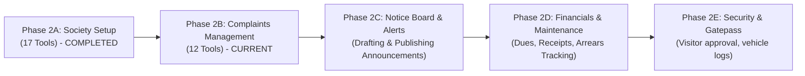

# Sahayak — AI Service Guide Part 3 (Phase 2B: Complaints Management Agent Tools)

> **For AI Developer (Shubhranshu)**:
> This guide extends the agentic AI assistant with a **complete complaint management toolset** —
> 12 new tools that give the secretary full natural-language control over the complaint lifecycle,
> analytics, and communication threads, all through the same conversational interface.
>
> **Prerequisites**:
> - Phase 2A society setup tools are **already working** (see [AI_SERVICE_GUIDE_PART_2.md](./AI_SERVICE_GUIDE_PART_2.md))
> - Complaints backend is **already deployed** by Purvi (see [BACKEND_GUIDE_PART_3.md](./BACKEND_GUIDE_PART_3.md))
> - Database schemas: [COMPLAINTS_DB.md](./COMPLAINTS_DB.md), [USER_DB.md](./USER_DB.md)
> - Multi-key failover & Gemini sanitizer are **already working** (see [BUGFIX_ROADMAP.md](./BUGFIX_ROADMAP.md))

---

## Table of Contents

1. [Phase 2A Recap — What We Have Now](#1-phase-2a-recap--what-we-have-now)
2. [Phase 2B Goal — What We're Building](#2-phase-2b-goal--what-were-building)
3. [Complaint Lifecycle — Status State Machine](#3-complaint-lifecycle--status-state-machine)
4. [Tool Design Principles (Phase 2B Specific)](#4-tool-design-principles-phase-2b-specific)
5. [Complete Tool Catalog — Complaints Management](#5-complete-tool-catalog--complaints-management)
   - [Tool 18: `get_complaint_stats`](#tool-18-get_complaint_stats)
   - [Tool 19: `list_complaints`](#tool-19-list_complaints)
   - [Tool 20: `get_complaint_details`](#tool-20-get_complaint_details)
   - [Tool 21: `update_complaint_status`](#tool-21-update_complaint_status)
   - [Tool 22: `reply_to_complaint`](#tool-22-reply_to_complaint)
   - [Tool 23: `reject_complaint`](#tool-23-reject_complaint)
   - [Tool 24: `get_complaints_by_category`](#tool-24-get_complaints_by_category)
   - [Tool 25: `get_complaints_by_unit`](#tool-25-get_complaints_by_unit)
   - [Tool 26: `get_complaints_by_resident`](#tool-26-get_complaints_by_resident)
   - [Tool 27: `search_complaints`](#tool-27-search_complaints)
   - [Tool 28: `get_complaint_thread`](#tool-28-get_complaint_thread)
   - [Tool 29: `get_resolution_metrics`](#tool-29-get_resolution_metrics)
6. [Tool Quick-Reference Table](#6-tool-quick-reference-table)
7. [Updated Graph Architecture — Phase 2B](#7-updated-graph-architecture--phase-2b)
8. [File: `graph/tools/complaints.py` — Complete Implementation](#8-file-graphtoolscomplaintspy--complete-implementation)
9. [Updates to `graph/tools/__init__.py`](#9-updates-to-graphtools__init__py)
10. [Updated System Prompt — Complaint-Aware Agent Persona](#10-updated-system-prompt--complaint-aware-agent-persona)
11. [No Changes Required: Graph Builder, Router, call_model](#11-no-changes-required-graph-builder-router-call_model)
12. [Edge Cases & Validation Matrix](#12-edge-cases--validation-matrix)
13. [Natural Language → Tool Mapping (Conversation Examples)](#13-natural-language--tool-mapping-conversation-examples)
14. [Implementation Order — Step by Step](#14-implementation-order--step-by-step)
15. [File-by-File Change Summary](#15-file-by-file-change-summary)
16. [Design Decisions Log (Phase 2B)](#16-design-decisions-log-phase-2b)
17. [Team Progress Analysis: Purvi (Backend) vs Shubhranshu (AI Core)](#17-team-progress-analysis-purvi-backend-vs-shubhranshu-ai-core)
18. [Verification Playbook & Next Steps (Phase 2B to 2C)](#18-verification-playbook--next-steps-phase-2b-to-2c)

---

## 1. Phase 2A Recap — What We Have Now

### Current Tool Inventory (17 Tools)

| # | Tool | Domain |
|---|---|---|
| 1-2 | `get_society_info`, `update_society_info` | Society Config |
| 3-6 | `get_society_structure`, `add_blocks`, `rename_block`, `delete_block` | Block Management |
| 7-8 | `add_floors`, `delete_floor` | Floor Management |
| 9-11 | `add_units`, `edit_unit`, `delete_unit` | Unit Management |
| 12 | `get_dashboard_stats` | Dashboard |
| 13-17 | `get_residents_list`, `approve_resident`, `reject_resident`, `revoke_resident`, `reactivate_resident` | Residents |

### Current Graph Topology (Unchanged)

```
START → route_start → [summarize_node →] call_model ⇄ tool_executor → END
```

### Current File Layout

```
ai-service/app/
├── graph/
│   ├── tools/
│   │   ├── __init__.py          ← tool registry (Phase 2A: 17 tools)
│   │   └── society_setup.py     ← 17 society tools
│   ├── builder.py               ← graph wiring
│   ├── edges/routers.py         ← route_start + route_after_model
│   ├── nodes/call_model.py      ← LLM invocation with failover
│   ├── nodes/summarize.py       ← sliding window compaction
│   ├── sanitizer.py             ← Gemini turn-order validator
│   └── state.py                 ← AgentState TypedDict
├── prompts/system.py            ← system prompt builder
├── services/
│   ├── llm_provider.py          ← multi-key/model failover engine
│   ├── chat_service.py          ← SSE streaming orchestration
│   └── history_service.py       ← MongoDB chat persistence
└── database/
    ├── mongodb.py               ← MongoDB connection + checkpointer
    └── mysql.py                 ← aiomysql connection pool
```

---

## 2. Phase 2B Goal — What We're Building

**The secretary says in natural language:**
> *"Show me all open complaints. How many plumbing issues do we have this month?
> Mark complaint #101 as resolved and tell the resident we fixed the pipe."*

**The agent:**
1. Calls `list_complaints(status_filter="open")` → gets all open complaints
2. Calls `get_complaints_by_category(category="plumbing")` → counts plumbing issues
3. Calls `update_complaint_status(complaint_id=101, new_status="pending_closure")` → marks as pending
4. Calls `reply_to_complaint(complaint_id=101, message="The plumbing team has fixed the pipe...")` → sends reply
5. Reports back: *"There are 5 open complaints. 3 are plumbing-related. Complaint #101 has been marked as Pending Closure and a reply sent to the resident."*

### Scope of Phase 2B (This Guide)

| Domain | Operations |
|---|---|
| **Complaint Analytics** | Dashboard stats, category breakdown, resolution metrics, top-offending units |
| **Complaint Listing** | List all society complaints with status/category/search filters & pagination |
| **Complaint Details** | View full complaint details + discussion thread |
| **Status Management** | Move to `in_progress`, `pending_closure`, or `rejected` (with reason) |
| **Communication** | Post secretary replies to complaint threads |
| **Targeted Queries** | Complaints by category, by unit, by resident, by search keyword |
| **Performance Metrics** | Average resolution time, high-frequency complaint units |

### NOT in Phase 2B (Out of Scope)

- Resident-facing tool calls (residents interact via frontend UI, not via AI agent)
- Photo/attachment uploads via tools (handled by frontend Cloudinary integration)
- Auto-close cron job (already implemented in Node.js backend service)
- Human-in-the-loop interrupt/approval nodes (Phase 2C)

---

## 3. Complaint Lifecycle — Status State Machine

Understanding this state machine is **critical** for tool validation logic. Every status transition
tool must enforce these rules at the database level.

```
Resident raises complaint (via frontend UI)
         │
         ▼
     [ OPEN ]  ◀──────────────────────────────────────────────────────────────────┐
         │                                                                         │
         │  Secretary replies / starts working (via AI tool or frontend)           │
         ▼                                                                         │
  [ IN_PROGRESS ] ◀─────────────────────────────────────────────────────────────  │
         │                          │                                              │
         │                          │ Secretary rejects (must provide reason)      │
         │                          ▼                                              │
         │                    [ REJECTED ]  ← TERMINAL, no further action          │
         │                                                                         │
         │  Secretary marks "pending_closure"                                      │
         ▼                                                                         │
 [ PENDING_CLOSURE ]                                                               │
         │                                                                         │
         ├── Resident confirms via frontend ──────────────▶ [ CLOSED ] (TERMINAL) │
         │                                                                         │
         └── Resident reopens via frontend ────────────────── back to ────────────┘
                                                              [ IN_PROGRESS ]

Auto-close (Node.js cron — no AI tool needed):
  IF status = 'pending_closure' AND updated_at < NOW() - INTERVAL 7 DAY:
    → UPDATE status = 'closed', closed_at = NOW()
    → INSERT system reply: "Auto-closed after 7 days with no response."
```

### Secretary-Allowed Status Transitions (AI Tool Scope)

| Current Status | Allowed Targets | Via Tool |
|---|---|---|
| `open` | `in_progress`, `rejected` | `update_complaint_status`, `reject_complaint` |
| `in_progress` | `pending_closure`, `rejected` | `update_complaint_status`, `reject_complaint` |
| `pending_closure` | `in_progress` (re-address), `rejected` | `update_complaint_status`, `reject_complaint` |
| `closed` | ❌ NONE (terminal) | — |
| `rejected` | ❌ NONE (terminal) | — |

### Secretary CANNOT Do

- **Set status to `closed`** → Only the resident can confirm closure (or auto-close cron)
- **Set status to `open`** → `open` is the initial state only, set on creation
- **Reply to `closed` or `rejected`** → Terminal states block all further interaction

### Auto-Advance Rule

When a secretary sends a reply (via `reply_to_complaint`) to a complaint that is still `open`,
the tool **automatically** advances the status to `in_progress`. This mirrors Purvi's backend behavior
where a secretary's first reply signals that the issue is being worked on.

---

## 4. Tool Design Principles (Phase 2B Specific)

### 4.1 Consistent Return Structure (Same as Phase 2A)

```python
# Success
return {
    "success": True,
    "message": "Human-readable summary of what happened.",
    "data": { ... }  # Structured data the LLM can reason about
}

# Error
return {
    "success": False,
    "error": "Human-readable error message the LLM can relay."
}
```

### 4.2 Society Isolation (Same Security Model)

Every tool reads `society_id` from `RunnableConfig["configurable"]["society_id"]`.
A secretary's agent can **never** access complaints from another society.

### 4.3 Pagination with Sensible Defaults

Complaint listing tools return paginated results. The LLM handles pagination
transparently — if the secretary asks for "all complaints", the tool returns the
first page and includes `totalCount` so the LLM can report the total.

### 4.4 Rich Data for LLM Reasoning

Complaint tools return **rich context** (resident name, unit label, timestamps, reply counts)
so the LLM can compose detailed, specific responses without needing follow-up tool calls.

### 4.5 Granular vs Composite Tools

We provide both **granular** tools (filter by single criterion) and **composite** tools
(full-featured listing with multiple filters). This gives the LLM flexibility:
- Simple question → use the specific granular tool
- Complex dashboard query → use the composite listing tool

---

## 5. Complete Tool Catalog — Complaints Management

### File: `graph/tools/complaints.py`

All 12 complaint tools live in one file, following the same pattern as `society_setup.py`.

---

### Tool 18: `get_complaint_stats`

**Purpose**: Fetch comprehensive complaint analytics — status breakdown, category distribution,
average resolution time, and top-offending units. This is the secretary's "complaint dashboard".

**When LLM Uses It**: *"How many complaints do we have?"*, *"Show me complaint statistics"*,
*"What's our average resolution time?"*, *"Which units have the most complaints?"*

**Backend Equivalent**: Maps to Purvi's `GET /api/v1/secretary/complaints/stats` (API 10).

```python
@tool
async def get_complaint_stats(config: RunnableConfig) -> Dict[str, Any]:
    """Get comprehensive complaint analytics for the society: total counts by status
    (open, in_progress, pending_closure, closed, rejected), breakdown by category
    (plumbing, electrical, lift, etc.), average resolution time in hours and days,
    and the top 5 units with the most complaints raised."""

    society_id = _extract_society_id(config)
    if not society_id:
        return {"success": False, "error": "Unauthorized: Missing society context."}

    try:
        pool = await get_mysql_pool()
        async with pool.acquire() as conn:
            async with conn.cursor() as cur:
                # 1. Status breakdown
                await cur.execute(
                    """SELECT
                        COUNT(*) AS total,
                        SUM(status = 'open') AS cnt_open,
                        SUM(status = 'in_progress') AS cnt_in_progress,
                        SUM(status = 'pending_closure') AS cnt_pending_closure,
                        SUM(status = 'closed') AS cnt_closed,
                        SUM(status = 'rejected') AS cnt_rejected
                    FROM complaints WHERE society_id = %s""",
                    (society_id,),
                )
                status_row = await cur.fetchone()

                # 2. Category breakdown
                await cur.execute(
                    """SELECT category, COUNT(*) AS cnt
                    FROM complaints WHERE society_id = %s
                    GROUP BY category ORDER BY cnt DESC""",
                    (society_id,),
                )
                category_rows = await cur.fetchall()

                # 3. Average resolution time (only closed complaints with closed_at)
                await cur.execute(
                    """SELECT AVG(TIMESTAMPDIFF(HOUR, created_at, closed_at)) AS avg_hours
                    FROM complaints
                    WHERE society_id = %s AND status = 'closed' AND closed_at IS NOT NULL""",
                    (society_id,),
                )
                time_row = await cur.fetchone()

                # 4. Top 5 units with most complaints
                await cur.execute(
                    """SELECT u.id AS unit_id, u.display_label, u.block_name,
                              u.floor_number, COUNT(c.id) AS complaint_count
                    FROM complaints c
                    JOIN units u ON c.unit_id = u.id
                    WHERE c.society_id = %s
                    GROUP BY u.id, u.display_label, u.block_name, u.floor_number
                    ORDER BY complaint_count DESC
                    LIMIT 5""",
                    (society_id,),
                )
                top_units = await cur.fetchall()

        # Assemble response
        by_category = {}
        for r in category_rows:
            by_category[r["category"]] = int(r["cnt"])

        avg_hours = float(time_row["avg_hours"]) if time_row and time_row.get("avg_hours") else 0.0
        avg_hours = round(avg_hours, 1)
        avg_days = round(avg_hours / 24, 1) if avg_hours > 0 else 0.0

        return {
            "success": True,
            "data": {
                "summary": {
                    "total": int(status_row["total"] or 0),
                    "open": int(status_row["cnt_open"] or 0),
                    "inProgress": int(status_row["cnt_in_progress"] or 0),
                    "pendingClosure": int(status_row["cnt_pending_closure"] or 0),
                    "closed": int(status_row["cnt_closed"] or 0),
                    "rejected": int(status_row["cnt_rejected"] or 0),
                },
                "byCategory": by_category,
                "performance": {
                    "avgResolutionHours": avg_hours,
                    "avgResolutionDays": avg_days,
                },
                "topComplaintUnits": [
                    {
                        "unitId": r["unit_id"],
                        "displayLabel": r["display_label"],
                        "blockName": r["block_name"],
                        "floorNumber": r["floor_number"],
                        "complaintCount": int(r["complaint_count"]),
                    }
                    for r in top_units
                ],
            },
        }
    except Exception as e:
        logger.error("Error in get_complaint_stats: %s", e, exc_info=True)
        return {"success": False, "error": f"Database error: {str(e)}"}
```

---

### Tool 19: `list_complaints`

**Purpose**: List all complaints in the society with powerful filtering (status, category, search)
and pagination. Returns summary status counts alongside the list for quick overviews.

**When LLM Uses It**: *"Show me all open complaints"*, *"List complaints about plumbing"*,
*"Search for complaints mentioning 'water'"*, *"Show me rejected complaints"*

**Backend Equivalent**: Maps to Purvi's `GET /api/v1/secretary/complaints` (API 8).

```python
@tool
async def list_complaints(
    config: RunnableConfig,
    status_filter: Optional[str] = None,
    category_filter: Optional[str] = None,
    search_query: Optional[str] = None,
    page: int = 1,
    limit: int = 20,
) -> Dict[str, Any]:
    """List all complaints in the society with optional filters. Supports filtering by:
    - status_filter: 'open', 'in_progress', 'pending_closure', 'closed', 'rejected'
    - category_filter: 'plumbing', 'electrical', 'lift', 'cleanliness', 'security', 'parking', 'noise', 'other'
    - search_query: text to search in title, description, resident name, or unit label
    Returns paginated results along with summary counts across all statuses."""

    society_id = _extract_society_id(config)
    if not society_id:
        return {"success": False, "error": "Unauthorized: Missing society context."}

    # Validate filters
    valid_statuses = ["open", "in_progress", "pending_closure", "closed", "rejected"]
    valid_categories = ["plumbing", "electrical", "lift", "cleanliness", "security", "parking", "noise", "other"]

    if status_filter and status_filter.lower() not in valid_statuses:
        return {"success": False, "error": f"Invalid status. Must be one of: {', '.join(valid_statuses)}"}
    if category_filter and category_filter.lower() not in valid_categories:
        return {"success": False, "error": f"Invalid category. Must be one of: {', '.join(valid_categories)}"}

    page = max(1, page)
    limit = max(1, min(limit, 50))
    offset = (page - 1) * limit

    try:
        pool = await get_mysql_pool()
        async with pool.acquire() as conn:
            async with conn.cursor() as cur:
                # 1. Summary counts (always unfiltered for the overview badges)
                await cur.execute(
                    """SELECT
                        COUNT(*) AS total,
                        SUM(status = 'open') AS cnt_open,
                        SUM(status = 'in_progress') AS cnt_in_progress,
                        SUM(status = 'pending_closure') AS cnt_pending_closure,
                        SUM(status = 'closed') AS cnt_closed,
                        SUM(status = 'rejected') AS cnt_rejected
                    FROM complaints WHERE society_id = %s""",
                    (society_id,),
                )
                counts_row = await cur.fetchone()

                # 2. Build filtered query
                conditions = ["c.society_id = %s"]
                params: list = [society_id]

                if status_filter:
                    conditions.append("c.status = %s")
                    params.append(status_filter.lower())
                if category_filter:
                    conditions.append("c.category = %s")
                    params.append(category_filter.lower())
                if search_query and search_query.strip():
                    like_pattern = f"%{search_query.strip()}%"
                    conditions.append(
                        "(c.title LIKE %s OR c.description LIKE %s OR u.name LIKE %s OR un.display_label LIKE %s)"
                    )
                    params.extend([like_pattern] * 4)

                where_clause = " AND ".join(conditions)

                # 3. Get filtered total
                count_sql = f"""
                    SELECT COUNT(*) AS total
                    FROM complaints c
                    JOIN users u ON c.resident_id = u.id
                    JOIN units un ON c.unit_id = un.id
                    WHERE {where_clause}
                """
                await cur.execute(count_sql, tuple(params))
                filtered_total = int((await cur.fetchone())["total"])

                # 4. Fetch paginated complaints
                list_sql = f"""
                    SELECT
                        c.id, c.title, c.category, c.category_label,
                        c.status, c.created_at, c.updated_at, c.closed_at,
                        c.rejection_reason,
                        u.id AS resident_id, u.name AS resident_name,
                        u.phone AS resident_phone, u.email AS resident_email,
                        un.id AS unit_id, un.display_label AS unit_label,
                        un.block_name, un.floor_number,
                        (SELECT COUNT(*) FROM complaint_replies WHERE complaint_id = c.id) AS reply_count
                    FROM complaints c
                    JOIN users u ON c.resident_id = u.id
                    JOIN units un ON c.unit_id = un.id
                    WHERE {where_clause}
                    ORDER BY c.created_at DESC
                    LIMIT %s OFFSET %s
                """
                await cur.execute(list_sql, (*params, limit, offset))
                rows = await cur.fetchall()

        complaints = [
            {
                "id": r["id"],
                "title": r["title"],
                "category": r["category"],
                "categoryLabel": r["category_label"],
                "status": r["status"],
                "rejectionReason": r["rejection_reason"],
                "createdAt": str(r["created_at"]) if r.get("created_at") else None,
                "updatedAt": str(r["updated_at"]) if r.get("updated_at") else None,
                "closedAt": str(r["closed_at"]) if r.get("closed_at") else None,
                "replyCount": int(r["reply_count"] or 0),
                "resident": {
                    "id": r["resident_id"],
                    "name": r["resident_name"],
                    "phone": r["resident_phone"],
                    "email": r["resident_email"],
                },
                "unit": {
                    "id": r["unit_id"],
                    "displayLabel": r["unit_label"],
                    "blockName": r["block_name"],
                    "floorNumber": r["floor_number"],
                },
            }
            for r in rows
        ]

        return {
            "success": True,
            "data": {
                "counts": {
                    "total": int(counts_row["total"] or 0),
                    "open": int(counts_row["cnt_open"] or 0),
                    "inProgress": int(counts_row["cnt_in_progress"] or 0),
                    "pendingClosure": int(counts_row["cnt_pending_closure"] or 0),
                    "closed": int(counts_row["cnt_closed"] or 0),
                    "rejected": int(counts_row["cnt_rejected"] or 0),
                },
                "complaints": complaints,
                "pagination": {
                    "page": page,
                    "limit": limit,
                    "total": filtered_total,
                    "totalPages": max(1, -(-filtered_total // limit)),  # ceiling division
                },
            },
        }
    except Exception as e:
        logger.error("Error in list_complaints: %s", e, exc_info=True)
        return {"success": False, "error": f"Database error: {str(e)}"}
```

---

### Tool 20: `get_complaint_details`

**Purpose**: Fetch full details of a single complaint including resident info, unit info,
current status, and the complete chronological discussion thread (all replies).

**When LLM Uses It**: *"Show me complaint #101"*, *"What's the status of complaint 42?"*,
*"Show me the thread for complaint about water leakage"*

**Backend Equivalent**: Maps to Purvi's `GET /api/v1/complaints/:id` (API 4).

```python
@tool
async def get_complaint_details(
    config: RunnableConfig,
    complaint_id: int,
) -> Dict[str, Any]:
    """Get full details of a specific complaint including resident info, unit info,
    current status, rejection reason (if rejected), and the complete chronological
    discussion thread with all replies from residents, secretary, and system."""

    society_id = _extract_society_id(config)
    if not society_id:
        return {"success": False, "error": "Unauthorized: Missing society context."}

    try:
        pool = await get_mysql_pool()
        async with pool.acquire() as conn:
            async with conn.cursor() as cur:
                # 1. Fetch complaint with resident and unit info
                await cur.execute(
                    """SELECT
                        c.id, c.title, c.category, c.category_label,
                        c.description, c.attachment_url, c.status,
                        c.rejection_reason, c.closed_at, c.created_at, c.updated_at,
                        u.id AS resident_id, u.name AS resident_name,
                        u.email AS resident_email, u.phone AS resident_phone,
                        un.id AS unit_id, un.display_label AS unit_label,
                        un.block_name, un.floor_number
                    FROM complaints c
                    JOIN users u ON c.resident_id = u.id
                    JOIN units un ON c.unit_id = un.id
                    WHERE c.id = %s AND c.society_id = %s""",
                    (complaint_id, society_id),
                )
                complaint = await cur.fetchone()

                if not complaint:
                    return {"success": False, "error": f"Complaint #{complaint_id} not found in this society."}

                # 2. Fetch discussion thread (chronological)
                await cur.execute(
                    """SELECT
                        r.id, r.sender_id, r.sender_role, r.message,
                        r.attachment_url, r.created_at,
                        u.name AS sender_name
                    FROM complaint_replies r
                    LEFT JOIN users u ON r.sender_id = u.id
                    WHERE r.complaint_id = %s
                    ORDER BY r.created_at ASC""",
                    (complaint_id,),
                )
                replies = await cur.fetchall()

        thread = [
            {
                "id": r["id"],
                "senderId": r["sender_id"],
                "senderRole": r["sender_role"],
                "senderName": "System" if r["sender_role"] == "system" else (r["sender_name"] or "Unknown"),
                "message": r["message"],
                "attachmentUrl": r["attachment_url"],
                "createdAt": str(r["created_at"]) if r.get("created_at") else None,
            }
            for r in replies
        ]

        c = complaint
        return {
            "success": True,
            "data": {
                "complaint": {
                    "id": c["id"],
                    "title": c["title"],
                    "category": c["category"],
                    "categoryLabel": c["category_label"],
                    "description": c["description"],
                    "attachmentUrl": c["attachment_url"],
                    "status": c["status"],
                    "rejectionReason": c["rejection_reason"],
                    "createdAt": str(c["created_at"]) if c.get("created_at") else None,
                    "updatedAt": str(c["updated_at"]) if c.get("updated_at") else None,
                    "closedAt": str(c["closed_at"]) if c.get("closed_at") else None,
                },
                "resident": {
                    "id": c["resident_id"],
                    "name": c["resident_name"],
                    "email": c["resident_email"],
                    "phone": c["resident_phone"],
                },
                "unit": {
                    "id": c["unit_id"],
                    "displayLabel": c["unit_label"],
                    "blockName": c["block_name"],
                    "floorNumber": c["floor_number"],
                },
                "thread": thread,
                "totalReplies": len(thread),
            },
        }
    except Exception as e:
        logger.error("Error in get_complaint_details: %s", e, exc_info=True)
        return {"success": False, "error": f"Database error: {str(e)}"}
```

---

### Tool 21: `update_complaint_status`

**Purpose**: Change a complaint's status to `in_progress` or `pending_closure`.
Automatically inserts a status-change reply into the complaint thread.

**When LLM Uses It**: *"Mark complaint #101 as in progress"*, *"Mark complaint 42 as resolved"*,
*"Set complaint 15 to pending closure"*

**Backend Equivalent**: Maps to Purvi's `PATCH /api/v1/secretary/complaints/:id/status` (API 9)
— but only for `in_progress` and `pending_closure`. Rejection has its own dedicated tool.

**Why separate from `reject_complaint`?** Rejection requires a mandatory `reason` parameter.
Keeping it as a separate tool gives the LLM a clear signal that a reason must be gathered first.

```python
@tool
async def update_complaint_status(
    config: RunnableConfig,
    complaint_id: int,
    new_status: str,
) -> Dict[str, Any]:
    """Update a complaint's status to 'in_progress' or 'pending_closure'.
    Cannot set status to 'closed' (only the resident can confirm closure) or
    'rejected' (use the reject_complaint tool instead, which requires a reason).
    Automatically inserts a status-change notification in the complaint thread."""

    society_id = _extract_society_id(config)
    if not society_id:
        return {"success": False, "error": "Unauthorized: Missing society context."}

    allowed = ["in_progress", "pending_closure"]
    new_status_lower = new_status.strip().lower()

    if new_status_lower == "closed":
        return {
            "success": False,
            "error": "Secretary cannot directly close a complaint. Set status to 'pending_closure' — the resident must confirm resolution, or it auto-closes after 7 days."
        }
    if new_status_lower == "rejected":
        return {
            "success": False,
            "error": "Use the reject_complaint tool instead, which requires a rejection reason."
        }
    if new_status_lower not in allowed:
        return {"success": False, "error": f"Invalid status. Must be one of: {', '.join(allowed)}"}

    try:
        pool = await get_mysql_pool()
        async with pool.acquire() as conn:
            async with conn.cursor() as cur:
                # 1. Fetch and lock complaint
                await cur.execute(
                    "SELECT id, status, title FROM complaints WHERE id = %s AND society_id = %s",
                    (complaint_id, society_id),
                )
                complaint = await cur.fetchone()

                if not complaint:
                    return {"success": False, "error": f"Complaint #{complaint_id} not found in this society."}

                current = complaint["status"]

                # 2. Terminal state checks
                if current == "closed":
                    return {"success": False, "error": f"Complaint #{complaint_id} is already closed. No further status changes allowed."}
                if current == "rejected":
                    return {"success": False, "error": f"Complaint #{complaint_id} is already rejected. No further status changes allowed."}

                # 3. Prevent no-op transitions
                if current == new_status_lower:
                    return {"success": True, "message": f"Complaint #{complaint_id} is already '{current}'. No change needed."}

                # 4. Update status
                await cur.execute(
                    "UPDATE complaints SET status = %s WHERE id = %s",
                    (new_status_lower, complaint_id),
                )

                # 5. Insert status-change notification reply
                if new_status_lower == "pending_closure":
                    system_msg = "Secretary marked this complaint as Pending Closure. Awaiting resident confirmation."
                else:
                    system_msg = "Secretary marked this complaint as In Progress."

                await cur.execute(
                    """INSERT INTO complaint_replies (complaint_id, sender_id, sender_role, message)
                       VALUES (%s, NULL, 'system', %s)""",
                    (complaint_id, system_msg),
                )
                await conn.commit()

        status_label = "Pending Closure" if new_status_lower == "pending_closure" else "In Progress"
        return {
            "success": True,
            "message": f"Complaint #{complaint_id} ('{complaint['title']}') status updated from '{current}' to '{status_label}'.",
            "data": {
                "complaintId": complaint_id,
                "previousStatus": current,
                "newStatus": new_status_lower,
            },
        }
    except Exception as e:
        logger.error("Error in update_complaint_status: %s", e, exc_info=True)
        return {"success": False, "error": f"Database error: {str(e)}"}
```

---

### Tool 22: `reply_to_complaint`

**Purpose**: Post a secretary reply/message in a complaint's discussion thread.
If the complaint is `open`, it **automatically** advances to `in_progress`.

**When LLM Uses It**: *"Tell the resident of complaint #101 that the plumber is coming tomorrow"*,
*"Reply to complaint 42 saying we've contacted the vendor"*

**Backend Equivalent**: Maps to Purvi's `POST /api/v1/complaints/:id/replies` (API 5)
— secretary path only.

```python
@tool
async def reply_to_complaint(
    config: RunnableConfig,
    complaint_id: int,
    message: str,
) -> Dict[str, Any]:
    """Post a secretary reply in a complaint's discussion thread. The message
    will be visible to both the resident and secretary. If the complaint is
    currently 'open', it is automatically advanced to 'in_progress'.
    Cannot reply to 'closed' or 'rejected' complaints."""

    society_id = _extract_society_id(config)
    if not society_id:
        return {"success": False, "error": "Unauthorized: Missing society context."}

    if not message or not message.strip():
        return {"success": False, "error": "Message cannot be empty."}

    clean_message = message.strip()
    if len(clean_message) < 2:
        return {"success": False, "error": "Reply message is too short (minimum 2 characters)."}

    try:
        pool = await get_mysql_pool()
        async with pool.acquire() as conn:
            async with conn.cursor() as cur:
                # 1. Fetch complaint
                await cur.execute(
                    "SELECT id, status, title FROM complaints WHERE id = %s AND society_id = %s",
                    (complaint_id, society_id),
                )
                complaint = await cur.fetchone()

                if not complaint:
                    return {"success": False, "error": f"Complaint #{complaint_id} not found in this society."}

                current_status = complaint["status"]

                # 2. Terminal state checks
                if current_status == "closed":
                    return {"success": False, "error": f"Cannot reply to complaint #{complaint_id}: it is already closed."}
                if current_status == "rejected":
                    return {"success": False, "error": f"Cannot reply to complaint #{complaint_id}: it is already rejected."}

                # 3. Auto-advance: open → in_progress on secretary reply
                status_advanced = False
                if current_status == "open":
                    await cur.execute(
                        "UPDATE complaints SET status = 'in_progress' WHERE id = %s",
                        (complaint_id,),
                    )
                    status_advanced = True

                # 4. Insert secretary reply (sender_role = 'secretary', sender_id = NULL for AI agent)
                # Note: We use sender_id = NULL and sender_role = 'secretary' because the AI agent
                # acts on behalf of the secretary but doesn't have a user ID in the system.
                await cur.execute(
                    """INSERT INTO complaint_replies (complaint_id, sender_id, sender_role, message)
                       VALUES (%s, NULL, 'secretary', %s)""",
                    (complaint_id, clean_message),
                )
                reply_id = cur.lastrowid
                await conn.commit()

        result_msg = f"Reply posted to complaint #{complaint_id} ('{complaint['title']}')."
        if status_advanced:
            result_msg += " Status automatically advanced from 'open' to 'in_progress'."

        return {
            "success": True,
            "message": result_msg,
            "data": {
                "replyId": reply_id,
                "complaintId": complaint_id,
                "senderRole": "secretary",
                "statusAdvanced": status_advanced,
            },
        }
    except Exception as e:
        logger.error("Error in reply_to_complaint: %s", e, exc_info=True)
        return {"success": False, "error": f"Database error: {str(e)}"}
```

---

### Tool 23: `reject_complaint`

**Purpose**: Reject a complaint with a mandatory reason. This is a terminal action — the
complaint cannot be reopened after rejection.

**When LLM Uses It**: *"Reject complaint #42, it's not a society issue"*,
*"This complaint about interior paint is outside our scope, reject it"*

**Backend Equivalent**: Maps to Purvi's `PATCH /api/v1/secretary/complaints/:id/status`
with `status: 'rejected'` (API 9) — separated into its own tool for safety.

```python
@tool
async def reject_complaint(
    config: RunnableConfig,
    complaint_id: int,
    rejection_reason: str,
) -> Dict[str, Any]:
    """Reject a complaint with a mandatory reason. This is a TERMINAL action — the complaint
    cannot be reopened or replied to after rejection. The rejection reason must be at least
    5 characters and will be visible to the resident. Cannot reject already closed or rejected complaints."""

    society_id = _extract_society_id(config)
    if not society_id:
        return {"success": False, "error": "Unauthorized: Missing society context."}

    if not rejection_reason or not rejection_reason.strip():
        return {"success": False, "error": "Rejection reason is required."}

    clean_reason = rejection_reason.strip()
    if len(clean_reason) < 5:
        return {"success": False, "error": "Rejection reason must be at least 5 characters."}
    if len(clean_reason) > 500:
        return {"success": False, "error": "Rejection reason must be under 500 characters."}

    try:
        pool = await get_mysql_pool()
        async with pool.acquire() as conn:
            async with conn.cursor() as cur:
                # 1. Fetch complaint
                await cur.execute(
                    "SELECT id, status, title FROM complaints WHERE id = %s AND society_id = %s",
                    (complaint_id, society_id),
                )
                complaint = await cur.fetchone()

                if not complaint:
                    return {"success": False, "error": f"Complaint #{complaint_id} not found in this society."}

                current = complaint["status"]
                if current == "closed":
                    return {"success": False, "error": f"Complaint #{complaint_id} is already closed. Cannot reject."}
                if current == "rejected":
                    return {"success": False, "error": f"Complaint #{complaint_id} is already rejected."}

                # 2. Update to rejected with reason
                await cur.execute(
                    "UPDATE complaints SET status = 'rejected', rejection_reason = %s WHERE id = %s",
                    (clean_reason, complaint_id),
                )

                # 3. Insert rejection notification reply
                await cur.execute(
                    """INSERT INTO complaint_replies (complaint_id, sender_id, sender_role, message)
                       VALUES (%s, NULL, 'system', %s)""",
                    (complaint_id, f"Secretary rejected this complaint. Reason: {clean_reason}"),
                )
                await conn.commit()

        return {
            "success": True,
            "message": f"Complaint #{complaint_id} ('{complaint['title']}') has been rejected. Reason: {clean_reason}",
            "data": {
                "complaintId": complaint_id,
                "previousStatus": current,
                "newStatus": "rejected",
                "rejectionReason": clean_reason,
            },
        }
    except Exception as e:
        logger.error("Error in reject_complaint: %s", e, exc_info=True)
        return {"success": False, "error": f"Database error: {str(e)}"}
```

---

### Tool 24: `get_complaints_by_category`

**Purpose**: Get all complaints filtered by a specific category. Quick targeted query
for the LLM when the secretary asks about a specific type of issue.

**When LLM Uses It**: *"How many plumbing complaints do we have?"*,
*"Show me all electrical complaints"*, *"Any parking issues this month?"*

```python
@tool
async def get_complaints_by_category(
    config: RunnableConfig,
    category: str,
    status_filter: Optional[str] = None,
) -> Dict[str, Any]:
    """Get complaints filtered by category (plumbing, electrical, lift, cleanliness,
    security, parking, noise, other). Optionally further filter by status.
    Returns a summary count and complaint list for the specified category."""

    society_id = _extract_society_id(config)
    if not society_id:
        return {"success": False, "error": "Unauthorized: Missing society context."}

    valid_categories = ["plumbing", "electrical", "lift", "cleanliness", "security", "parking", "noise", "other"]
    category_lower = category.strip().lower()
    if category_lower not in valid_categories:
        return {"success": False, "error": f"Invalid category. Must be one of: {', '.join(valid_categories)}"}

    valid_statuses = ["open", "in_progress", "pending_closure", "closed", "rejected"]
    if status_filter and status_filter.lower() not in valid_statuses:
        return {"success": False, "error": f"Invalid status filter. Must be one of: {', '.join(valid_statuses)}"}

    try:
        pool = await get_mysql_pool()
        async with pool.acquire() as conn:
            async with conn.cursor() as cur:
                conditions = ["c.society_id = %s", "c.category = %s"]
                params: list = [society_id, category_lower]

                if status_filter:
                    conditions.append("c.status = %s")
                    params.append(status_filter.lower())

                where_clause = " AND ".join(conditions)

                await cur.execute(
                    f"""SELECT
                        c.id, c.title, c.status, c.category_label,
                        c.created_at, c.updated_at,
                        u.name AS resident_name,
                        un.display_label AS unit_label
                    FROM complaints c
                    JOIN users u ON c.resident_id = u.id
                    JOIN units un ON c.unit_id = un.id
                    WHERE {where_clause}
                    ORDER BY c.created_at DESC
                    LIMIT 50""",
                    tuple(params),
                )
                rows = await cur.fetchall()

        complaints = [
            {
                "id": r["id"],
                "title": r["title"],
                "status": r["status"],
                "categoryLabel": r["category_label"],
                "residentName": r["resident_name"],
                "unitLabel": r["unit_label"],
                "createdAt": str(r["created_at"]) if r.get("created_at") else None,
            }
            for r in rows
        ]

        return {
            "success": True,
            "data": {
                "category": category_lower,
                "statusFilter": status_filter,
                "totalCount": len(complaints),
                "complaints": complaints,
            },
        }
    except Exception as e:
        logger.error("Error in get_complaints_by_category: %s", e, exc_info=True)
        return {"success": False, "error": f"Database error: {str(e)}"}
```

---

### Tool 25: `get_complaints_by_unit`

**Purpose**: Get all complaints originating from a specific unit. Useful for investigating
recurring issues or problem units.

**When LLM Uses It**: *"Are there recurring complaints from unit A-101?"*,
*"Show me all complaints from unit B-204"*

```python
@tool
async def get_complaints_by_unit(
    config: RunnableConfig,
    unit_id: int,
) -> Dict[str, Any]:
    """Get all complaints raised from a specific unit. Returns the unit details
    and a chronological list of all complaints from that unit with status and category."""

    society_id = _extract_society_id(config)
    if not society_id:
        return {"success": False, "error": "Unauthorized: Missing society context."}

    try:
        pool = await get_mysql_pool()
        async with pool.acquire() as conn:
            async with conn.cursor() as cur:
                # 1. Verify unit belongs to society
                await cur.execute(
                    "SELECT id, display_label, block_name, floor_number, status FROM units WHERE id = %s AND society_id = %s",
                    (unit_id, society_id),
                )
                unit = await cur.fetchone()
                if not unit:
                    return {"success": False, "error": f"Unit with ID {unit_id} not found in this society."}

                # 2. Fetch complaints for this unit
                await cur.execute(
                    """SELECT
                        c.id, c.title, c.category, c.category_label,
                        c.status, c.created_at, c.updated_at, c.closed_at,
                        u.name AS resident_name
                    FROM complaints c
                    JOIN users u ON c.resident_id = u.id
                    WHERE c.unit_id = %s AND c.society_id = %s
                    ORDER BY c.created_at DESC""",
                    (unit_id, society_id),
                )
                rows = await cur.fetchall()

        complaints = [
            {
                "id": r["id"],
                "title": r["title"],
                "category": r["category"],
                "categoryLabel": r["category_label"],
                "status": r["status"],
                "residentName": r["resident_name"],
                "createdAt": str(r["created_at"]) if r.get("created_at") else None,
                "closedAt": str(r["closed_at"]) if r.get("closed_at") else None,
            }
            for r in rows
        ]

        return {
            "success": True,
            "data": {
                "unit": {
                    "id": unit["id"],
                    "displayLabel": unit["display_label"],
                    "blockName": unit["block_name"],
                    "floorNumber": unit["floor_number"],
                    "occupancyStatus": unit["status"],
                },
                "totalComplaints": len(complaints),
                "complaints": complaints,
            },
        }
    except Exception as e:
        logger.error("Error in get_complaints_by_unit: %s", e, exc_info=True)
        return {"success": False, "error": f"Database error: {str(e)}"}
```

---

### Tool 26: `get_complaints_by_resident`

**Purpose**: Get all complaints filed by a specific resident. Useful for understanding
a resident's complaint history.

**When LLM Uses It**: *"Show me all complaints from Aarav Sharma"*,
*"Has resident #15 raised any complaints?"*

```python
@tool
async def get_complaints_by_resident(
    config: RunnableConfig,
    resident_id: int,
) -> Dict[str, Any]:
    """Get all complaints filed by a specific resident. Returns the resident's details
    and a chronological list of their complaints with status and category."""

    society_id = _extract_society_id(config)
    if not society_id:
        return {"success": False, "error": "Unauthorized: Missing society context."}

    try:
        pool = await get_mysql_pool()
        async with pool.acquire() as conn:
            async with conn.cursor() as cur:
                # 1. Verify resident belongs to society
                await cur.execute(
                    """SELECT id, name, email, phone, status AS user_status
                    FROM users WHERE id = %s AND society_id = %s AND role = 'resident'""",
                    (resident_id, society_id),
                )
                resident = await cur.fetchone()
                if not resident:
                    return {"success": False, "error": f"Resident with ID {resident_id} not found in this society."}

                # 2. Fetch complaints
                await cur.execute(
                    """SELECT
                        c.id, c.title, c.category, c.category_label,
                        c.status, c.created_at, c.updated_at, c.closed_at,
                        un.display_label AS unit_label
                    FROM complaints c
                    JOIN units un ON c.unit_id = un.id
                    WHERE c.resident_id = %s AND c.society_id = %s
                    ORDER BY c.created_at DESC""",
                    (resident_id, society_id),
                )
                rows = await cur.fetchall()

        complaints = [
            {
                "id": r["id"],
                "title": r["title"],
                "category": r["category"],
                "categoryLabel": r["category_label"],
                "status": r["status"],
                "unitLabel": r["unit_label"],
                "createdAt": str(r["created_at"]) if r.get("created_at") else None,
                "closedAt": str(r["closed_at"]) if r.get("closed_at") else None,
            }
            for r in rows
        ]

        return {
            "success": True,
            "data": {
                "resident": {
                    "id": resident["id"],
                    "name": resident["name"],
                    "email": resident["email"],
                    "phone": resident["phone"],
                    "accountStatus": resident["user_status"],
                },
                "totalComplaints": len(complaints),
                "complaints": complaints,
            },
        }
    except Exception as e:
        logger.error("Error in get_complaints_by_resident: %s", e, exc_info=True)
        return {"success": False, "error": f"Database error: {str(e)}"}
```

---

### Tool 27: `search_complaints`

**Purpose**: Full-text search across complaint titles, descriptions, resident names, and unit labels.
Dedicated search tool for natural-language queries.

**When LLM Uses It**: *"Search for complaints about 'water leakage'"*,
*"Find any complaint mentioning 'parking lot'"*, *"Are there complaints about the lift?"*

```python
@tool
async def search_complaints(
    config: RunnableConfig,
    query: str,
    limit: int = 20,
) -> Dict[str, Any]:
    """Search complaints by keyword across title, description, resident name, and unit label.
    Returns matching complaints ordered by relevance (newest first). Minimum 2 characters required."""

    society_id = _extract_society_id(config)
    if not society_id:
        return {"success": False, "error": "Unauthorized: Missing society context."}

    if not query or len(query.strip()) < 2:
        return {"success": False, "error": "Search query must be at least 2 characters."}

    clean_query = query.strip()
    like_pattern = f"%{clean_query}%"
    limit = max(1, min(limit, 50))

    try:
        pool = await get_mysql_pool()
        async with pool.acquire() as conn:
            async with conn.cursor() as cur:
                await cur.execute(
                    """SELECT
                        c.id, c.title, c.category, c.status, c.description,
                        c.created_at,
                        u.name AS resident_name,
                        un.display_label AS unit_label
                    FROM complaints c
                    JOIN users u ON c.resident_id = u.id
                    JOIN units un ON c.unit_id = un.id
                    WHERE c.society_id = %s
                      AND (c.title LIKE %s OR c.description LIKE %s
                           OR u.name LIKE %s OR un.display_label LIKE %s)
                    ORDER BY c.created_at DESC
                    LIMIT %s""",
                    (society_id, like_pattern, like_pattern, like_pattern, like_pattern, limit),
                )
                rows = await cur.fetchall()

        results = [
            {
                "id": r["id"],
                "title": r["title"],
                "category": r["category"],
                "status": r["status"],
                "description": r["description"][:200] + "..." if r["description"] and len(r["description"]) > 200 else r["description"],
                "residentName": r["resident_name"],
                "unitLabel": r["unit_label"],
                "createdAt": str(r["created_at"]) if r.get("created_at") else None,
            }
            for r in rows
        ]

        return {
            "success": True,
            "data": {
                "query": clean_query,
                "matchCount": len(results),
                "results": results,
            },
        }
    except Exception as e:
        logger.error("Error in search_complaints: %s", e, exc_info=True)
        return {"success": False, "error": f"Database error: {str(e)}"}
```

---

### Tool 28: `get_complaint_thread`

**Purpose**: Fetch only the discussion thread (replies) for a complaint, without the full
complaint details. Lightweight tool for when the LLM already has the complaint context and
just needs to check recent messages.

**When LLM Uses It**: *"What was the last message on complaint #101?"*,
*"Show me the replies for complaint 42"*

```python
@tool
async def get_complaint_thread(
    config: RunnableConfig,
    complaint_id: int,
) -> Dict[str, Any]:
    """Get the discussion thread (all replies) for a specific complaint.
    Returns chronological messages from residents, secretary, and system.
    Use get_complaint_details for the full complaint + thread together."""

    society_id = _extract_society_id(config)
    if not society_id:
        return {"success": False, "error": "Unauthorized: Missing society context."}

    try:
        pool = await get_mysql_pool()
        async with pool.acquire() as conn:
            async with conn.cursor() as cur:
                # Verify complaint belongs to society
                await cur.execute(
                    "SELECT id, title, status FROM complaints WHERE id = %s AND society_id = %s",
                    (complaint_id, society_id),
                )
                complaint = await cur.fetchone()
                if not complaint:
                    return {"success": False, "error": f"Complaint #{complaint_id} not found in this society."}

                # Fetch thread
                await cur.execute(
                    """SELECT
                        r.id, r.sender_id, r.sender_role, r.message,
                        r.attachment_url, r.created_at,
                        u.name AS sender_name
                    FROM complaint_replies r
                    LEFT JOIN users u ON r.sender_id = u.id
                    WHERE r.complaint_id = %s
                    ORDER BY r.created_at ASC""",
                    (complaint_id,),
                )
                replies = await cur.fetchall()

        thread = [
            {
                "id": r["id"],
                "senderRole": r["sender_role"],
                "senderName": "System" if r["sender_role"] == "system" else (r["sender_name"] or "Unknown"),
                "message": r["message"],
                "hasAttachment": bool(r["attachment_url"]),
                "createdAt": str(r["created_at"]) if r.get("created_at") else None,
            }
            for r in replies
        ]

        return {
            "success": True,
            "data": {
                "complaintId": complaint_id,
                "complaintTitle": complaint["title"],
                "complaintStatus": complaint["status"],
                "totalReplies": len(thread),
                "thread": thread,
            },
        }
    except Exception as e:
        logger.error("Error in get_complaint_thread: %s", e, exc_info=True)
        return {"success": False, "error": f"Database error: {str(e)}"}
```

---

### Tool 29: `get_resolution_metrics`

**Purpose**: Deep analytics on complaint resolution performance — average resolution time
with optional category/date filtering, resolution rate, and stale complaint detection.

**When LLM Uses It**: *"What's our average time to resolve plumbing complaints?"*,
*"How many complaints are pending for more than 3 days?"*, *"What's our resolution rate?"*

```python
@tool
async def get_resolution_metrics(
    config: RunnableConfig,
    category_filter: Optional[str] = None,
) -> Dict[str, Any]:
    """Get detailed resolution performance metrics: average resolution time,
    resolution rate (% of total that reached 'closed'), count of stale complaints
    (in_progress or pending_closure for more than 72 hours), and optionally filtered by category."""

    society_id = _extract_society_id(config)
    if not society_id:
        return {"success": False, "error": "Unauthorized: Missing society context."}

    valid_categories = ["plumbing", "electrical", "lift", "cleanliness", "security", "parking", "noise", "other"]
    if category_filter and category_filter.lower() not in valid_categories:
        return {"success": False, "error": f"Invalid category. Must be one of: {', '.join(valid_categories)}"}

    try:
        pool = await get_mysql_pool()
        async with pool.acquire() as conn:
            async with conn.cursor() as cur:
                base_condition = "society_id = %s"
                params: list = [society_id]

                if category_filter:
                    base_condition += " AND category = %s"
                    params.append(category_filter.lower())

                # 1. Total and closed counts
                await cur.execute(
                    f"""SELECT
                        COUNT(*) AS total,
                        SUM(status = 'closed') AS closed_count
                    FROM complaints WHERE {base_condition}""",
                    tuple(params),
                )
                count_row = await cur.fetchone()
                total = int(count_row["total"] or 0)
                closed = int(count_row["closed_count"] or 0)

                # 2. Average resolution time
                await cur.execute(
                    f"""SELECT AVG(TIMESTAMPDIFF(HOUR, created_at, closed_at)) AS avg_hours
                    FROM complaints
                    WHERE {base_condition} AND status = 'closed' AND closed_at IS NOT NULL""",
                    tuple(params),
                )
                time_row = await cur.fetchone()
                avg_hours = round(float(time_row["avg_hours"]), 1) if time_row and time_row.get("avg_hours") else 0.0

                # 3. Stale complaints (in_progress or pending_closure > 72 hours)
                await cur.execute(
                    f"""SELECT COUNT(*) AS stale_count
                    FROM complaints
                    WHERE {base_condition}
                      AND status IN ('in_progress', 'pending_closure')
                      AND updated_at < NOW() - INTERVAL 72 HOUR""",
                    tuple(params),
                )
                stale_row = await cur.fetchone()
                stale_count = int(stale_row["stale_count"] or 0)

                # 4. Active (non-terminal) complaints
                await cur.execute(
                    f"""SELECT COUNT(*) AS active_count
                    FROM complaints
                    WHERE {base_condition}
                      AND status IN ('open', 'in_progress', 'pending_closure')""",
                    tuple(params),
                )
                active_row = await cur.fetchone()
                active_count = int(active_row["active_count"] or 0)

        resolution_rate = round((closed / total * 100), 1) if total > 0 else 0.0

        return {
            "success": True,
            "data": {
                "categoryFilter": category_filter,
                "totalComplaints": total,
                "closedComplaints": closed,
                "activeComplaints": active_count,
                "resolutionRate": resolution_rate,
                "avgResolutionHours": avg_hours,
                "avgResolutionDays": round(avg_hours / 24, 1) if avg_hours > 0 else 0.0,
                "staleComplaints": stale_count,
                "staleThresholdHours": 72,
            },
        }
    except Exception as e:
        logger.error("Error in get_resolution_metrics: %s", e, exc_info=True)
        return {"success": False, "error": f"Database error: {str(e)}"}
```

---

## 6. Tool Quick-Reference Table

| # | Tool Name | Parameters | Secretary Says... |
|---|---|---|---|
| **18** | `get_complaint_stats` | *(none)* | "Show me complaint statistics" |
| **19** | `list_complaints` | `status_filter?`, `category_filter?`, `search_query?`, `page?`, `limit?` | "Show all open complaints" |
| **20** | `get_complaint_details` | `complaint_id` | "Show me complaint #101" |
| **21** | `update_complaint_status` | `complaint_id`, `new_status` | "Mark #101 as resolved" |
| **22** | `reply_to_complaint` | `complaint_id`, `message` | "Tell them the plumber is coming" |
| **23** | `reject_complaint` | `complaint_id`, `rejection_reason` | "Reject #42, it's not our scope" |
| **24** | `get_complaints_by_category` | `category`, `status_filter?` | "How many plumbing complaints?" |
| **25** | `get_complaints_by_unit` | `unit_id` | "Complaints from unit A-101?" |
| **26** | `get_complaints_by_resident` | `resident_id` | "Complaints from Aarav Sharma?" |
| **27** | `search_complaints` | `query`, `limit?` | "Search for 'water leakage'" |
| **28** | `get_complaint_thread` | `complaint_id` | "Show replies for complaint #42" |
| **29** | `get_resolution_metrics` | `category_filter?` | "What's our resolution rate?" |

---

## 7. Updated Graph Architecture — Phase 2B

### Graph Topology (UNCHANGED from Phase 2A)

The graph structure does **not** change. The new complaint tools are simply registered
alongside the existing society setup tools. The `ToolNode` automatically discovers
and executes any registered tool.

```
                  ┌──────────────┐
                  │    START     │
                  └──────┬───────┘
                         │
              ┌──────────▼──────────┐
              │   route_start()     │
              │   len(msgs) > 30?   │
              └──────────┬──────────┘
                No ↙         ↘ Yes
    ┌──────────▼─────┐  ┌────▼────────────┐
    │                │  │ summarize_node   │
    │                │  └────┬────────────┘
    │                │       │
    │   call_model   │◄──────┘
    │   (Gemini +    │
    │    29 tools)   │               ← Was 17 tools, now 29
    └───────┬────────┘
            │
   ┌────────▼────────┐
   │  route_after_    │
   │  model()         │
   │  Has tool_calls? │
   └────────┬────────┘
     No ↙        ↘ Yes
    END    ┌──────▼──────────┐
           │ tool_executor   │
           │ (ToolNode)      │
           │ 29 tools avail  │     ← Was 17, now 29
           └──────┬──────────┘
                  │
                  ▼
            call_model  ← loop back with ToolMessage results
```

### Why No Graph Changes?

LangGraph's `ToolNode` is **dynamic** — it receives tools at construction time from `get_all_tools()`.
By adding new tools to the registry, they are automatically available in the graph.
No new nodes, no new edges, no new routing logic needed.

---

## 8. File: `graph/tools/complaints.py` — Complete Implementation

Create the file `ai-service/app/graph/tools/complaints.py` containing all 12 tools
from Section 5 above, with the following structure:

```python
"""
Sahayak AI Assistant — Complaints Management Tools (Phase 2B)

This module implements 12 agent tools for managing the complaint lifecycle,
analytics, and communication threads. All tools enforce society isolation
via society_id from RunnableConfig.

Tools:
  18. get_complaint_stats     — Dashboard analytics
  19. list_complaints         — Filtered listing with pagination
  20. get_complaint_details   — Full complaint + thread view
  21. update_complaint_status — Status transitions (in_progress / pending_closure)
  22. reply_to_complaint      — Secretary posts a reply in thread
  23. reject_complaint        — Reject with mandatory reason (terminal)
  24. get_complaints_by_category — Category-filtered listing
  25. get_complaints_by_unit  — Unit-scoped complaint history
  26. get_complaints_by_resident — Resident complaint history
  27. search_complaints       — Full-text keyword search
  28. get_complaint_thread    — Thread-only view (lightweight)
  29. get_resolution_metrics  — Resolution time & stale complaint detection
"""

import logging
from typing import Any, Dict, List, Optional
from langchain_core.runnables import RunnableConfig
from langchain_core.tools import tool
from app.database.mysql import get_mysql_pool

logger = logging.getLogger(__name__)


def _extract_society_id(config: Optional[RunnableConfig]) -> Optional[int]:
    """Helper to extract and validate society_id from LangGraph RunnableConfig."""
    if not config:
        return None
    configurable = config.get("configurable", {})
    society_id = configurable.get("society_id")
    if society_id is not None:
        try:
            return int(society_id)
        except (ValueError, TypeError):
            return None
    return None


# === Paste all 12 tool functions from Section 5 here ===


def get_complaint_tools() -> List[Any]:
    """Return all 12 complaint management tools as a flat list."""
    return [
        get_complaint_stats,
        list_complaints,
        get_complaint_details,
        update_complaint_status,
        reply_to_complaint,
        reject_complaint,
        get_complaints_by_category,
        get_complaints_by_unit,
        get_complaints_by_resident,
        search_complaints,
        get_complaint_thread,
        get_resolution_metrics,
    ]
```

---

## 9. Updates to `graph/tools/__init__.py`

The `__init__.py` must aggregate tools from both `society_setup.py` and the new `complaints.py`:

```python
"""Agent tools package for Sahayak LangGraph assistant."""

from app.graph.tools.society_setup import (
    get_all_tools as _get_society_tools,
    # ... existing individual imports ...
)

from app.graph.tools.complaints import (
    get_complaint_tools as _get_complaint_tools,
    get_complaint_stats,
    list_complaints,
    get_complaint_details,
    update_complaint_status,
    reply_to_complaint,
    reject_complaint,
    get_complaints_by_category,
    get_complaints_by_unit,
    get_complaints_by_resident,
    search_complaints,
    get_complaint_thread,
    get_resolution_metrics,
)


def get_all_tools():
    """Return all registered agent tools (society setup + complaints)."""
    return _get_society_tools() + _get_complaint_tools()


__all__ = [
    "get_all_tools",
    # Society tools (existing)
    "get_society_info", "update_society_info",
    "get_society_structure", "add_blocks", "rename_block", "delete_block",
    "add_floors", "delete_floor",
    "add_units", "edit_unit", "delete_unit",
    "get_dashboard_stats",
    "get_residents_list", "approve_resident", "reject_resident",
    "revoke_resident", "reactivate_resident",
    # Complaint tools (new)
    "get_complaint_stats", "list_complaints", "get_complaint_details",
    "update_complaint_status", "reply_to_complaint", "reject_complaint",
    "get_complaints_by_category", "get_complaints_by_unit",
    "get_complaints_by_resident", "search_complaints",
    "get_complaint_thread", "get_resolution_metrics",
]
```

**The `get_all_tools()` function is the single source of truth used by both `builder.py`
(for `ToolNode(tools)`) and `call_model.py` (for `provider.bind_tools(tools)`).**
By updating it here, both consumers automatically get the new complaint tools.

---

## 10. Updated System Prompt — Complaint-Aware Agent Persona

The system prompt in `prompts/system.py` must be updated to include the complaint tools
in the capabilities catalog, along with complaint-specific behavioral guidelines.

### Changes to `build_system_prompt()`

Add the following section after the existing `### Resident Management Tools` block:

```python
### Complaint Management Tools
- **get_complaint_stats**: View complaint dashboard (counts by status/category, avg resolution time, top units)
- **list_complaints**: List all society complaints with status/category/search filters and pagination
- **get_complaint_details**: View full complaint details + chronological discussion thread
- **update_complaint_status**: Move complaint to 'in_progress' or 'pending_closure'
- **reply_to_complaint**: Post a secretary reply in the complaint thread
- **reject_complaint**: Reject a complaint with a mandatory reason (terminal, irreversible)
- **get_complaints_by_category**: Filter complaints by category (plumbing, electrical, etc.)
- **get_complaints_by_unit**: View all complaints from a specific unit
- **get_complaints_by_resident**: View all complaints filed by a specific resident
- **search_complaints**: Search complaints by keyword across titles, descriptions, names, and units
- **get_complaint_thread**: View only the discussion thread for a complaint
- **get_resolution_metrics**: Detailed resolution performance metrics with optional category filter
```

And add these complaint-specific behavioral guidelines:

```python
## Complaint-Specific Guidelines

9. **Complaint Status Rules** — Only set status to 'in_progress' or 'pending_closure'. You CANNOT:
   - Set status to 'closed' (only the resident can confirm closure via the app)
   - Set status to 'open' (this is the initial state set on creation only)
   - Modify closed or rejected complaints (they are terminal states)

10. **Rejection is permanent** — When rejecting a complaint, always confirm with the secretary
    first and ensure they provide a clear reason. Rejected complaints cannot be undone.

11. **Auto-advance on reply** — When replying to an 'open' complaint, the status automatically
    moves to 'in_progress'. Inform the secretary of this automatic transition.

12. **Rich complaint summaries** — When listing complaints, present them in a clean, structured
    format with complaint ID, title, status, category, resident name, and unit. Use tables or
    bullet points for readability.
```

---

## 11. No Changes Required: Graph Builder, Router, call_model

The following files require **ZERO modifications** for Phase 2B:

| File | Why No Change |
|---|---|
| [`builder.py`](file:///d:/Codes/MAJOR%20PROJECT/Sahayak/ai-service/app/graph/builder.py) | Uses `get_all_tools()` which now returns 29 tools automatically |
| [`routers.py`](file:///d:/Codes/MAJOR%20PROJECT/Sahayak/ai-service/app/graph/edges/routers.py) | Tool detection logic is generic (`if AIMessage has tool_calls`) |
| [`call_model.py`](file:///d:/Codes/MAJOR%20PROJECT/Sahayak/ai-service/app/graph/nodes/call_model.py) | Uses `get_all_tools()` for `provider.bind_tools()` — automatic |
| [`state.py`](file:///d:/Codes/MAJOR%20PROJECT/Sahayak/ai-service/app/graph/state.py) | No new state fields needed — tool state flows via messages |
| [`sanitizer.py`](file:///d:/Codes/MAJOR%20PROJECT/Sahayak/ai-service/app/graph/sanitizer.py) | Turn-order sanitization is message-type agnostic |
| [`chat_service.py`](file:///d:/Codes/MAJOR%20PROJECT/Sahayak/ai-service/app/services/chat_service.py) | SSE streaming handles all tool types identically |
| [`llm_provider.py`](file:///d:/Codes/MAJOR%20PROJECT/Sahayak/ai-service/app/services/llm_provider.py) | Failover engine is tool-agnostic |
| [`mysql.py`](file:///d:/Codes/MAJOR%20PROJECT/Sahayak/ai-service/app/database/mysql.py) | Connection pool already configured |

**This is the power of the extensible architecture from Phase 2A** — adding new tool domains
requires creating one new tool file, updating `__init__.py`, and updating the system prompt.

---

## 12. Edge Cases & Validation Matrix

### Status Transition Validation

| Scenario | Tool | Current Status | Action | Expected Result |
|---|---|---|---|---|
| Mark open as in_progress | `update_complaint_status` | `open` | `in_progress` | ✅ Status updated + system reply |
| Mark in_progress as pending_closure | `update_complaint_status` | `in_progress` | `pending_closure` | ✅ Status updated + system reply |
| Secretary tries to close directly | `update_complaint_status` | any | `closed` | ❌ Error: "Secretary cannot directly close" |
| Secretary tries to set open | `update_complaint_status` | any | `open` | ❌ Error: "Invalid status" |
| Update already closed complaint | `update_complaint_status` | `closed` | any | ❌ Error: "Already closed" |
| Update already rejected complaint | `update_complaint_status` | `rejected` | any | ❌ Error: "Already rejected" |
| No-op transition | `update_complaint_status` | `in_progress` | `in_progress` | ✅ "Already in_progress, no change" |

### Reply Validation

| Scenario | Tool | Expected Result |
|---|---|---|
| Reply to open complaint | `reply_to_complaint` | ✅ Reply posted + auto-advance to `in_progress` |
| Reply to in_progress | `reply_to_complaint` | ✅ Reply posted, status unchanged |
| Reply to pending_closure | `reply_to_complaint` | ✅ Reply posted, status unchanged |
| Reply to closed complaint | `reply_to_complaint` | ❌ Error: "Cannot reply to closed" |
| Reply to rejected complaint | `reply_to_complaint` | ❌ Error: "Cannot reply to rejected" |
| Empty message | `reply_to_complaint` | ❌ Error: "Message cannot be empty" |

### Rejection Validation

| Scenario | Tool | Expected Result |
|---|---|---|
| Reject with valid reason | `reject_complaint` | ✅ Rejected + reason stored + system reply |
| Reject without reason | `reject_complaint` | ❌ Error: "Rejection reason is required" |
| Reject with short reason (<5 chars) | `reject_complaint` | ❌ Error: "At least 5 characters" |
| Reject already closed | `reject_complaint` | ❌ Error: "Already closed" |
| Reject already rejected | `reject_complaint` | ❌ Error: "Already rejected" |

### Cross-Society Isolation

| Scenario | Expected Result |
|---|---|
| Secretary queries complaint from another society | ❌ "Not found in this society" |
| Tool called without society_id in config | ❌ "Unauthorized: Missing society context" |
| Tool queries unit from another society | ❌ "Unit not found in this society" |

### Filter Validation

| Scenario | Tool | Expected Result |
|---|---|---|
| Invalid status filter | `list_complaints` | ❌ Error with valid options listed |
| Invalid category filter | `get_complaints_by_category` | ❌ Error with valid categories listed |
| Empty search query | `search_complaints` | ❌ Error: "At least 2 characters" |
| Non-existent complaint ID | `get_complaint_details` | ❌ "Complaint #X not found" |
| Non-existent resident ID | `get_complaints_by_resident` | ❌ "Resident not found" |
| Non-existent unit ID | `get_complaints_by_unit` | ❌ "Unit not found" |

---

## 13. Natural Language → Tool Mapping (Conversation Examples)

### Example 1: Secretary asks for overview
```
Secretary: "How are our complaints looking?"
Agent thinks: Secretary wants a general overview → use get_complaint_stats

[Tool Call] get_complaint_stats()
[Tool Result] { summary: { total: 24, open: 5, inProgress: 4, ... }, byCategory: {...} }

Agent: "Here's your complaint dashboard:
📊 **Total Complaints**: 24
- 🟢 Open: 5
- 🔵 In Progress: 4
- 🟡 Pending Closure: 3
- ✅ Closed: 10
- ❌ Rejected: 2

📈 **Average Resolution Time**: 18.5 hours (0.8 days)
📋 **Top Category**: Plumbing (9 complaints)"
```

### Example 2: Multi-step complaint handling
```
Secretary: "Show me the open plumbing complaints and mark the oldest one as in progress"
Agent thinks: Need to list open plumbing complaints, then update the oldest

[Tool Call 1] list_complaints(status_filter="open", category_filter="plumbing")
[Tool Result] { complaints: [{ id: 105, title: "Pipe burst", createdAt: "2026-10-01" }, ...] }

[Tool Call 2] update_complaint_status(complaint_id=105, new_status="in_progress")
[Tool Result] { success: true, message: "Complaint #105 status updated to In Progress" }

Agent: "Found 3 open plumbing complaints:
1. **#105** — Pipe burst in bathroom (A-101, Oct 1) — ✅ Now marked In Progress
2. **#108** — Drainage blockage (B-202, Oct 3)
3. **#112** — Water pressure low (A-301, Oct 5)"
```

### Example 3: Rejection with confirmation
```
Secretary: "Reject complaint #42, the resident is complaining about their interior paint"
Agent thinks: Rejection is terminal. Need to confirm and extract reason.

Agent: "I'll reject complaint #42. Just to confirm — the rejection reason would be:
'Interior paint maintenance is the resident's private responsibility, not covered under
society common area maintenance.' Shall I proceed with this?"

Secretary: "Yes, go ahead"

[Tool Call] reject_complaint(complaint_id=42, rejection_reason="Interior paint maintenance...")
[Tool Result] { success: true }

Agent: "✅ Complaint #42 has been rejected. The resident will see the reason:
'Interior paint maintenance is the resident's private responsibility, not covered under
society common area maintenance.'"
```

### Example 4: Reply and auto-advance
```
Secretary: "Reply to complaint #110 saying we've assigned a plumber for tomorrow 10am"

[Tool Call] reply_to_complaint(complaint_id=110, message="A plumber has been assigned...")
[Tool Result] { success: true, statusAdvanced: true }

Agent: "✅ Reply sent to complaint #110. Note: Since this was the first response,
the status has been automatically moved from 'Open' to 'In Progress'."
```

### Example 5: Investigation query
```
Secretary: "Which unit has the most complaints?"

[Tool Call] get_complaint_stats()
[Tool Result] { topComplaintUnits: [{ displayLabel: "A-101", complaintCount: 7 }] }

Agent: "Unit **A-101** (Tower A, Floor 1) has the highest complaint frequency with
**7 complaints**. Want me to show you the details of their complaints?"
```

---

## 14. Implementation Order — Step by Step

| Step | What to Do | File | Est. Time |
|---|---|---|---|
| **1** | Create `complaints.py` with all 12 tools | `graph/tools/complaints.py` | 30 min |
| **2** | Update `__init__.py` to register complaint tools | `graph/tools/__init__.py` | 5 min |
| **3** | Update system prompt with complaint tool catalog | `prompts/system.py` | 10 min |
| **4** | Test tool registration (startup log: "29 tools") | `python -m app.main` | 5 min |
| **5** | Test each tool individually via chat | Chat UI | 20 min |
| **6** | Test multi-tool chains (list + update + reply) | Chat UI | 15 min |
| **7** | Test edge cases (invalid status, cross-society) | Chat UI | 15 min |
| **8** | Commit to `ai` branch, merge to `dev`, push | Git | 5 min |

**Total estimated implementation time: ~1.5 hours**

---

## 15. File-by-File Change Summary

| File | Change Type | Description |
|---|---|---|
| `graph/tools/complaints.py` | **NEW** | 12 complaint management tools (~500 lines) |
| `graph/tools/__init__.py` | **MODIFY** | Import + register complaint tools, update `get_all_tools()` |
| `prompts/system.py` | **MODIFY** | Add complaint tools catalog + complaint behavioral guidelines |
| `graph/builder.py` | ❌ No change | Auto-discovers new tools via `get_all_tools()` |
| `graph/edges/routers.py` | ❌ No change | Generic tool detection logic |
| `graph/nodes/call_model.py` | ❌ No change | Auto-discovers tools via `get_all_tools()` |
| `graph/state.py` | ❌ No change | No new state fields needed |
| `graph/sanitizer.py` | ❌ No change | Turn-order sanitization is tool-agnostic |
| `services/llm_provider.py` | ❌ No change | Failover engine is tool-agnostic |
| `services/chat_service.py` | ❌ No change | SSE streaming handles all tools identically |
| `database/mysql.py` | ❌ No change | Connection pool already configured |

---

## 16. Design Decisions Log (Phase 2B)

### DD-1: Why 12 tools instead of fewer composite tools?

**Problem**: Should we have one massive `manage_complaint(action, ...)` tool or many small ones?

**Decision**: Many small, focused tools.

**Rationale**: The LLM makes better tool selection decisions when each tool has a clear,
single-purpose docstring. A mega-tool with 10 actions requires the LLM to construct complex
argument objects, increasing hallucination risk. Small tools = clear intent = fewer errors.

### DD-2: Why separate `reject_complaint` from `update_complaint_status`?

**Problem**: Rejection is technically a status update. Why not just allow `status: 'rejected'`
in `update_complaint_status`?

**Decision**: Separate tool with mandatory `rejection_reason` parameter.

**Rationale**: Rejection is a **terminal, irreversible** action with a mandatory reason field.
By making it a separate tool, the LLM is forced to acknowledge the severity and provide a reason.
If combined, the LLM might accidentally reject without a reason, triggering a confusing validation error.

### DD-3: Why `sender_id = NULL` for AI agent replies?

**Problem**: When the AI agent posts a reply on behalf of the secretary, what `sender_id` should we use?

**Decision**: `sender_id = NULL` with `sender_role = 'secretary'`.

**Rationale**: The AI agent doesn't have its own `users` row. Using the secretary's actual
`user_id` would be misleading (the secretary didn't type the message). `NULL` with
`sender_role = 'secretary'` correctly represents "posted by the AI on behalf of the secretary".
The `LEFT JOIN` in reply queries already handles `NULL` sender_ids gracefully (designed for
system messages).

### DD-4: Why granular category/unit/resident tools alongside the composite `list_complaints`?

**Problem**: `list_complaints` already supports category and status filters. Why add dedicated tools?

**Decision**: Provide both granular and composite tools.

**Rationale**: When the secretary asks *"any plumbing complaints?"*, the LLM can call the simple
`get_complaints_by_category("plumbing")` instead of constructing `list_complaints(category_filter="plumbing")`.
Granular tools have simpler parameter schemas → lower LLM hallucination risk for simple queries.
The composite `list_complaints` is available for complex multi-filter queries.

### DD-5: Why not add resident-facing tools (confirm resolution, reopen)?

**Problem**: Should the AI agent be able to close or reopen complaints on behalf of residents?

**Decision**: No. These are resident-only actions accessed via the frontend UI.

**Rationale**: The AI agent serves the **secretary**. Allowing the secretary's agent to confirm
closure would bypass the resident's verification right — a core design principle of the complaint
lifecycle. The resident must explicitly confirm that their issue was resolved.

### DD-6: Why include status-change system replies?

**Problem**: When `update_complaint_status` changes a status, should it also insert a thread reply?

**Decision**: Yes — always insert a `sender_role = 'system'` reply on every status change.

**Rationale**: This mirrors Purvi's backend behavior exactly. The complaint thread serves as
a complete audit trail. Without system replies, status changes would appear as invisible jumps
in the timeline. The resident sees "Secretary marked this complaint as In Progress" in their
thread, providing transparency.


---

## 17. Team Progress Analysis: Purvi (Backend) vs Shubhranshu (AI Core)

### 17.1 Feature & Module Comparison Matrix

| Module / Capability | Purvi (Sahayak Backend - Node.js/Express) | Shubhranshu (AI Service - FastAPI/LangGraph) | Status & Alignment |
|---|---|---|---|
| **Module 1: Authentication & RBAC** | - JWT auth, cookies, refresh tokens<br>- Role-based guards (`superadmin`, `secretary`, `resident`)<br>- Password reset, profile update | - Stateless execution: receives `society_id`, `user_id`, `role` in `RunnableConfig`<br>- Enforces isolation at tool layer | Backend Complete.<br>AI Core Integrates seamlessly. |
| **Module 2: Society Structure** | - CRUD for societies, blocks, floors, units<br>- Occupancy assignments & validations<br>- 15+ REST endpoints | - **17 autonomous tools** implemented (`graph/tools/society_setup.py`)<br>- Natural language block, floor, unit, resident setup<br>- Comprehensive occupancy stats | **100% Parity Achieved** in Phase 2A. Tested & verified. |
| **Module 3: Complaints Ticket System** | - Complete complaint lifecycle state machine<br>- Threaded comments & system reply audit trail<br>- Category, unit, status filters & search<br>- Dashboard stats & metrics<br>- 12 REST endpoints implemented | - **12 autonomous tools** designed (`graph/tools/complaints.py`)<br>- Tools 18–29 covering stats, listings, transitions, replies, rejections<br>- AI acts as secretary assistant answering resident queries & managing tickets | Backend Complete.<br>AI Guide Part 3 Complete.<br>**Ready for Tool Implementation.** |
| **Module 4: Notice Board & Announcements** | - Planned in upcoming sprint | - Planned for Phase 2C (post-complaints) | Queued next after Complaints. |
| **Module 5: Maintenance & Invoicing** | - Planned in future sprint | - Planned for Phase 2D (financial tools) | Queued for Phase 2D. |
| **Module 6: Security & Visitor Log** | - Planned in future sprint | - Planned for Phase 2E (gatekeeper tools) | Queued for Phase 2E. |
| **Core Architecture & Infrastructure** | - Express REST APIs<br>- MySQL schema migrations (`complaints`, `complaint_replies`)<br>- Joi validation middleware | - LangGraph state graph with tool discovery<br>- Multi-key failover provider (`llm_provider.py`)<br>- Gemini function call turn sanitizer (`sanitizer.py`)<br>- SSE streaming (`chat_service.py`) | Production-ready AI Core engine with automated failover & turn validation. |

### 17.2 Velocity & Readiness Summary

1. **Purvi's Backend**:
   - Purvi has completely finalized and verified the Complaints module (`modules/complaints/`).
   - The MySQL database has active tables `complaints` and `complaint_replies` with foreign keys, indexes, and ENUM statuses (`open`, `in_progress`, `pending_closure`, `closed`, `rejected`).
   - Her backend is ready to accept both web UI traffic and direct database operations executed by the AI service.

2. **Shubhranshu's AI Service**:
   - Phase 2A (Society Setup with 17 tools) is 100% implemented, tested, and operational.
   - The recent critical bug (Gemini function turn 400 `INVALID_ARGUMENT`) has been thoroughly fixed via `sanitizer.py` and documented in `BUGFIX_ROADMAP.md`.
   - Multi-LLM failover supports round-robin / fallback between multiple Gemini keys and models.
   - Phase 2B (Complaints Management) is fully specified in this document with 12 complete tools ready to be dropped into `graph/tools/complaints.py`.

---

## 18. Verification Playbook & Next Steps (Phase 2B to 2C)

### 18.1 Quick Implementation Checklist

- [ ] **Step 1**: Create `ai-service/app/graph/tools/complaints.py` using the exact code from Section 5 & 8.
- [ ] **Step 2**: Edit `ai-service/app/graph/tools/__init__.py` to import `get_complaint_tools()` and concatenate to `get_all_tools()` (total count increases from 17 to 29).
- [ ] **Step 3**: Update `ai-service/app/prompts/system.py` to add the Complaint Tools section to the system prompt.
- [ ] **Step 4**: Restart `ai-service` and verify startup logs display:
  ```text
  INFO: Initialized LangGraph agent with 29 tools.
  ```
- [ ] **Step 5**: Run smoke test queries in the chat UI:
  - Query: *"Show me a summary of complaints in our society."* (Triggers `get_complaint_stats`)
  - Query: *"List all open plumbing complaints."* (Triggers `get_complaints_by_category` or `list_complaints`)
  - Query: *"Check ticket #3 and tell me what the resident reported."* (Triggers `get_complaint_details`)
  - Query: *"Reply to ticket #3 saying plumber is assigned and will visit at 4 PM."* (Triggers `reply_to_complaint`)
  - Query: *"Mark ticket #3 as in progress."* (Triggers `update_complaint_status`)
- [ ] **Step 6**: Push changes to branch `ai`, create PR or merge into `dev`, and push to remote.

### 18.2 What Comes Next (Roadmap Ahead)



1. **Immediate Next Action**: Implement the 12 complaint tools in `graph/tools/complaints.py`.
2. **Next Module (Phase 2C)**: Once Purvi finishes the Notice Board / Announcements module, create agent tools for the secretary to draft, publish, broadcast, and summarize society announcements.
