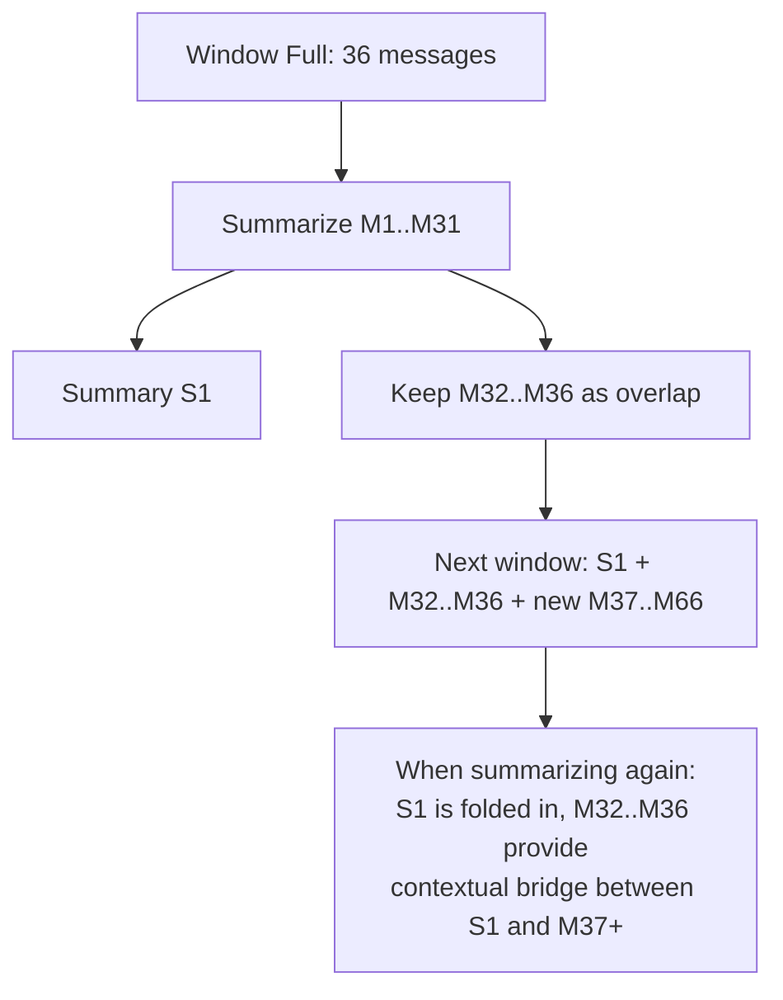
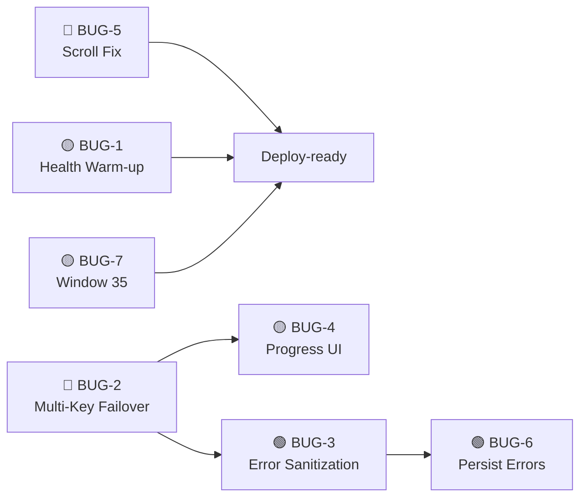
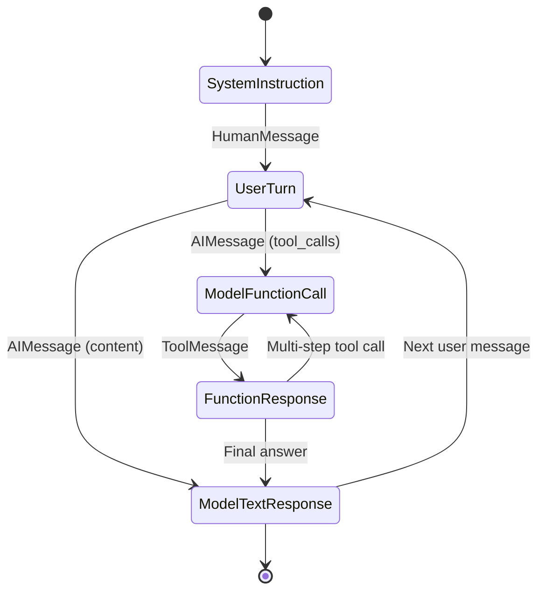
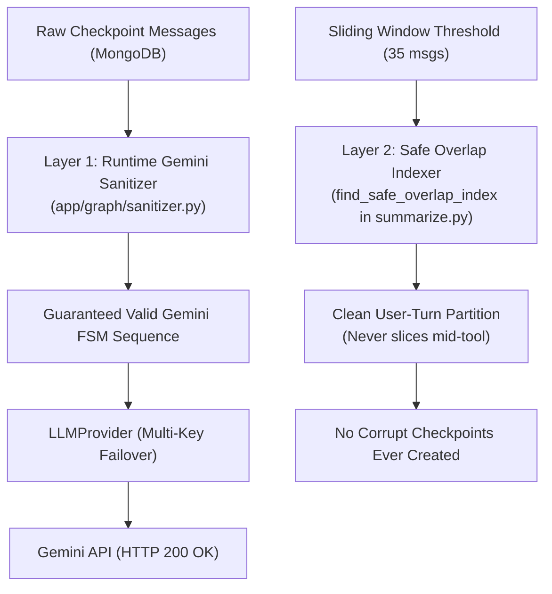

# Sahayak AI Service — Bug Fix & Improvement Roadmap

> **Generated**: 23 October 2026  
> **Scope**: All 7 items listed by the user, analyzed against the current codebase.  
> **Priority Legend**: 🔴 Do Now (blocks core experience) · 🟡 Do Before Deploy · 🟢 Do After Feature-Complete

---

## Table of Contents

1. [BUG-1: Health Endpoint — Keep Databases Warm (🟡 Pending)](#bug-1-health-endpoint--keep-databases-warm)
2. [BUG-2: Multi-API-Key & Multi-Model Failover (✅ Completed)](#bug-2-multi-api-key--multi-model-failover--completed)
3. [BUG-3: Error Messages Leaking to Chat UI (🟢 Planned)](#bug-3-error-messages-leaking-to-chat-ui)
4. [BUG-4: "Thinking" Status & Step-by-Step Progress UI (🟡 In Progress)](#bug-4-thinking-status--step-by-step-progress-ui)
5. [BUG-5: Chat Scrolls to Oldest Message on Load (✅ Completed)](#bug-5-chat-scrolls-to-oldest-message-on-load--completed)
6. [BUG-6: Error Messages Not Persisted — Disappear on Refresh (🟢 Planned)](#bug-6-error-messages-not-persisted--disappear-on-refresh)
7. [BUG-7: Sliding Window Summarization & Turn-Integrity (✅ Completed)](#bug-7-sliding-window-summarization--overlap-logic--completed)
8. [Implementation Priority Order](#implementation-priority-order)
9. [Post-Mortem & Deep-Dive: Gemini 400 INVALID_ARGUMENT Function-Call Invariant](#9-post-mortem--deep-dive-gemini-400-invalid_argument-function-call-invariant)

---

## BUG-1: Health Endpoint — Keep Databases Warm

**Priority**: 🟡 Do Before Deploy  
**Affects**: [main.py](file:///d:/Codes/MAJOR%20PROJECT/Sahayak/ai-service/app/main.py#L96-L146), [app.js](file:///d:/Codes/MAJOR%20PROJECT/Sahayak/sahayak_backend/src/app.js#L22-L29)

### Current State

The AI service `/health` endpoint **already** sends `SELECT 1` to MySQL and `ping` to MongoDB — this is correct. But the **Node.js backend** `/api/health` does **not** touch MySQL at all:

```javascript
// sahayak_backend/src/app.js — current
app.get('/api/health', (req, res) => {
  res.status(200).json({
    success: true,
    message: 'Sahayak Backend is running',
    timestamp: new Date().toISOString(),
  });
});
```

### Problem

The user's external "keep-alive bot" pings the Render-deployed Node.js backend every 5 minutes. Currently:
- ✅ **AI Service `/health`**: Already pings MongoDB (`admin.command("ping")`) and MySQL (`SELECT 1 AS ping`). This keeps both databases warm when the AI service is pinged.
- ❌ **Node.js Backend `/api/health`**: Returns a static JSON. It does **not** touch MySQL at all, so the database connection in the Node.js backend can still go cold.

### Solution

#### A. Node.js Backend — Add MySQL ping to `/api/health`

```javascript
// sahayak_backend/src/app.js — updated
const db = require('./config/db'); // or wherever the mysql pool is

app.get('/api/health', async (req, res) => {
  let dbStatus = 'unknown';
  try {
    const [rows] = await db.promise().query('SELECT 1 AS ping');
    dbStatus = 'connected';
  } catch (err) {
    dbStatus = `unhealthy: ${err.message}`;
  }

  res.status(200).json({
    success: true,
    message: 'Sahayak Backend is running',
    timestamp: new Date().toISOString(),
    database: { mysql: dbStatus },
  });
});
```

Also support `HEAD` method (for lightweight health-check bots):

```javascript
app.head('/api/health', (req, res) => res.sendStatus(200));
```

#### B. AI Service — Already Done ✅

The current [main.py](file:///d:/Codes/MAJOR%20PROJECT/Sahayak/ai-service/app/main.py#L96-L146) already does:
- MongoDB: `await client.admin.command("ping")`
- MySQL: `await cur.execute("SELECT 1 AS ping")`

No changes needed in the AI service.

#### C. Edge Case — MySQL Pool Goes Stale

Free-tier MySQL (AlwaysData) may close idle connections after ~600s. The `aiomysql` pool should set `pool_recycle` to avoid stale connection errors:

```python
# mysql.py — add pool_recycle
_pool = await aiomysql.create_pool(
    ...
    pool_recycle=300,  # Recycle connections older than 5 min
)
```

### Files to Change

| File | Change |
|------|--------|
| `sahayak_backend/src/app.js` | Add MySQL ping + HEAD support to `/api/health` |
| `ai-service/app/database/mysql.py` | Add `pool_recycle=300` to `create_pool()` |

---

## BUG-2: Multi-API-Key & Multi-Model Failover ✅ COMPLETED

**Status**: ✅ Implemented & Tested (23 Oct 2026)  
**Priority**: 🔴 Do Now (Completed)  
**Affects**: [config.py](file:///d:/Codes/MAJOR%20PROJECT/Sahayak/ai-service/app/config.py), [llm_provider.py](file:///d:/Codes/MAJOR%20PROJECT/Sahayak/ai-service/app/services/llm_provider.py), [call_model.py](file:///d:/Codes/MAJOR%20PROJECT/Sahayak/ai-service/app/graph/nodes/call_model.py), [summarize.py](file:///d:/Codes/MAJOR%20PROJECT/Sahayak/ai-service/app/graph/nodes/summarize.py)

### Current State

```python
# config.py — current: single key, single model
GEMINI_API_KEY: str = Field(default="")
GEMINI_MODEL: str = Field(default="gemini-1.5-flash")
```

```python
# call_model.py — current: one model, 2 retries, that's it
_models[temperature] = ChatGoogleGenerativeAI(
    model=settings.GEMINI_MODEL,
    google_api_key=settings.GEMINI_API_KEY,
    max_retries=2,
    timeout=60.0,
)
```

If the single API key hits quota or the single model is unavailable → **hard error**.

### Solution — The "LLM Provider Pool" Pattern

#### Step 1: Update `.env` Format

Store multiple API keys and models as **comma-separated** values:

```env
# .env — new format
GEMINI_API_KEYS=KEY_ACCOUNT_1,KEY_ACCOUNT_2,KEY_ACCOUNT_3
GEMINI_MODELS=gemini-2.5-flash,gemini-2.0-flash,gemini-1.5-flash
```

#### Step 2: Update `config.py`

```python
from typing import List

class Settings(BaseSettings):
    # Multi-key / multi-model failover
    GEMINI_API_KEYS: str = Field(
        default="",
        description="Comma-separated list of Gemini API keys from different accounts"
    )
    GEMINI_MODELS: str = Field(
        default="gemini-2.5-flash",
        description="Comma-separated list of Gemini models in priority order"
    )

    # Keep single-key for backward compat (fallback)
    GEMINI_API_KEY: str = Field(default="")
    GEMINI_MODEL: str = Field(default="gemini-1.5-flash")

    @property
    def api_keys(self) -> List[str]:
        """Parse comma-separated API keys into a list."""
        keys = [k.strip() for k in self.GEMINI_API_KEYS.split(",") if k.strip()]
        if not keys and self.GEMINI_API_KEY:
            keys = [self.GEMINI_API_KEY]
        return keys

    @property
    def models(self) -> List[str]:
        """Parse comma-separated model names into a list."""
        models = [m.strip() for m in self.GEMINI_MODELS.split(",") if m.strip()]
        if not models:
            models = [self.GEMINI_MODEL]
        return models
```

#### Step 3: Create `ai-service/app/services/llm_provider.py`

This is the core failover engine. It tries every (key, model) combination.

```python
"""
LLM Provider with automatic multi-key, multi-model failover.

Failover Order:
  For each model (in priority order):
    For each API key:
      Try the request.
      If 429 (quota) or 503 (unavailable) → try next key.
    If all keys exhausted for this model → try next model.
  If all combinations exhausted → raise final error.
"""

import logging
import asyncio
from typing import List, Optional, Tuple
from langchain_google_genai import ChatGoogleGenerativeAI
from langchain_core.messages import BaseMessage
from app.config import settings

logger = logging.getLogger(__name__)

# Errors that trigger failover (don't fail on user errors like bad prompts)
RETRYABLE_ERROR_KEYWORDS = [
    "quota",
    "resource_exhausted",
    "rate limit",
    "429",
    "503",
    "unavailable",
    "overloaded",
    "capacity",
    "too many requests",
]


def _is_retryable(error: Exception) -> bool:
    """Check if the error is a quota/availability issue worth retrying."""
    msg = str(error).lower()
    return any(kw in msg for kw in RETRYABLE_ERROR_KEYWORDS)


class LLMProvider:
    """Manages a pool of (api_key, model) combinations with automatic failover."""

    def __init__(self):
        self.api_keys: List[str] = settings.api_keys
        self.models: List[str] = settings.models
        self._current_model_idx = 0
        self._current_key_idx = 0
        self._tools = None

    @property
    def current_model(self) -> str:
        return self.models[self._current_model_idx]

    @property
    def current_key(self) -> str:
        return self.api_keys[self._current_key_idx]

    def _build_llm(
        self, api_key: str, model: str, temperature: float = 0.7
    ) -> ChatGoogleGenerativeAI:
        return ChatGoogleGenerativeAI(
            model=model,
            google_api_key=api_key,
            temperature=temperature,
            max_retries=1,    # Internal retries low; we handle failover ourselves
            timeout=45.0,
        )

    def bind_tools(self, tools):
        """Store tools for binding to each LLM instance."""
        self._tools = tools

    async def ainvoke_with_failover(
        self,
        messages: List[BaseMessage],
        temperature: float = 0.7,
        on_failover=None,  # Callback: async def on_failover(model, key_index, reason)
    ):
        """
        Try invoking the LLM. On retryable errors, cycle through keys and models.

        Args:
            messages: The LangChain messages to send.
            temperature: LLM temperature.
            on_failover: Optional async callback for UI progress updates.

        Returns:
            The AIMessage response.

        Raises:
            The last exception if all combinations are exhausted.
        """
        total_keys = len(self.api_keys)
        total_models = len(self.models)
        attempts = 0
        max_attempts = total_keys * total_models
        last_error = None

        for model_idx in range(total_models):
            model = self.models[(self._current_model_idx + model_idx) % total_models]

            for key_idx in range(total_keys):
                api_key = self.api_keys[(self._current_key_idx + key_idx) % total_keys]
                attempts += 1

                try:
                    llm = self._build_llm(api_key, model, temperature)
                    if self._tools:
                        llm = llm.bind_tools(self._tools)

                    response = await llm.ainvoke(messages)

                    # Success! Update preferred indices for next call
                    self._current_model_idx = (self._current_model_idx + model_idx) % total_models
                    self._current_key_idx = (self._current_key_idx + key_idx) % total_keys

                    if attempts > 1:
                        logger.info(
                            "LLM failover succeeded on attempt %d (model=%s, key_idx=%d)",
                            attempts, model, key_idx
                        )

                    return response

                except Exception as e:
                    last_error = e
                    if _is_retryable(e):
                        reason = str(e)[:120]
                        logger.warning(
                            "LLM attempt %d/%d failed (model=%s, key_idx=%d): %s. Trying next...",
                            attempts, max_attempts, model, key_idx, reason
                        )
                        if on_failover:
                            await on_failover(model, key_idx, reason)
                        await asyncio.sleep(0.5)  # Brief pause before retry
                    else:
                        # Non-retryable error (bad prompt, auth error) — raise immediately
                        raise

        # All combinations exhausted
        logger.error(
            "All %d LLM combinations exhausted. Last error: %s", max_attempts, last_error
        )
        raise last_error


# Singleton provider instance
_provider: Optional[LLMProvider] = None

def get_llm_provider() -> LLMProvider:
    global _provider
    if _provider is None:
        _provider = LLMProvider()
    return _provider
```

#### Step 4: Update `call_model.py` to Use the Provider

```python
# call_model.py — updated
from app.services.llm_provider import get_llm_provider

async def call_model(state: AgentState, config=None):
    # ... (system message building stays the same) ...

    provider = get_llm_provider()
    provider.bind_tools(get_all_tools())

    messages_to_send = [system_msg, *state["messages"]]
    response = await provider.ainvoke_with_failover(messages_to_send)

    return {"messages": [response]}
```

#### Edge Cases Handled

| Scenario | Behavior |
|----------|----------|
| Key 1 quota exceeded, Key 2 works | Switches to Key 2, same model |
| All keys exhausted for model A | Switches to model B with Key 1 |
| All combinations fail | Raises the last error (handled by `chat_service.py`) |
| Non-retryable error (bad API key) | Raises immediately, no failover |
| Success on attempt N | Updates internal state so next call starts from the working combination |

### Files to Create/Change

| File | Action |
|------|--------|
| `ai-service/.env` | Change `GEMINI_API_KEY` → `GEMINI_API_KEYS`, `GEMINI_MODEL` → `GEMINI_MODELS` |
| `ai-service/app/config.py` | Add `GEMINI_API_KEYS`, `GEMINI_MODELS`, and `api_keys`/`models` properties |
| `ai-service/app/services/llm_provider.py` | **New file** — Failover engine |
| `ai-service/app/graph/nodes/call_model.py` | Use `LLMProvider` instead of direct `ChatGoogleGenerativeAI` |

---

## BUG-3: Error Messages Leaking to Chat UI

**Priority**: 🟢 Do After Feature-Complete  
**Affects**: [chat_service.py](file:///d:/Codes/MAJOR%20PROJECT/Sahayak/ai-service/app/services/chat_service.py#L119-L122), [system.py](file:///d:/Codes/MAJOR%20PROJECT/Sahayak/ai-service/app/prompts/system.py#L66-L67)

### Current State

```python
# chat_service.py line 119-121 — current
except Exception as e:
    logger.error("Error during LangGraph stream execution: %s", e, exc_info=True)
    yield f"data: {json.dumps({'type': 'error', 'message': str(e)})}\n\n"
```

`str(e)` sends raw Python exception text like `httpcore.ReadTimeout`, `ResourceExhausted: 429 ...`, or full tracebacks to the frontend. The frontend then displays it in the chat bubble.

### Root Cause Analysis

Two separate issues:

1. **Backend leaks raw exception strings** to the SSE stream.
2. **The AI model itself sometimes includes error details in its response text** when a tool fails (e.g., MySQL connection errors). This comes from the system prompt rule: *"Handle errors gracefully — if a tool returns an error, explain clearly what went wrong."* The AI is dutifully reporting MySQL errors to the secretary.

### Solution

#### A. Sanitize Backend Errors in `chat_service.py`

```python
# chat_service.py — updated error handler
# Map of internal error patterns → user-friendly messages
ERROR_MAP = {
    "quota": "The AI service is temporarily at capacity. Please try again in a minute.",
    "rate limit": "Too many requests. Please wait a moment and try again.",
    "timeout": "The AI took too long to respond. Please try again.",
    "unavailable": "The AI model is temporarily unavailable. Retrying...",
    "connection": "A database connection issue occurred. Please try again shortly.",
}

def _sanitize_error(error: Exception) -> str:
    """Convert internal errors to user-friendly messages."""
    msg = str(error).lower()
    for pattern, friendly_msg in ERROR_MAP.items():
        if pattern in msg:
            return friendly_msg
    # Generic fallback — never leak raw tracebacks
    return "An unexpected issue occurred. Our team has been notified. Please try again."


# In the except block:
except Exception as e:
    logger.error("Error during LangGraph stream: %s", e, exc_info=True)
    safe_msg = _sanitize_error(e)
    yield f"data: {json.dumps({'type': 'error', 'message': safe_msg})}\n\n"
```

#### B. Add Guardrails to System Prompt for Tool Errors

Update [system.py](file:///d:/Codes/MAJOR%20PROJECT/Sahayak/ai-service/app/prompts/system.py) rule #5:

```diff
- 5. **Handle errors gracefully** — if a tool returns an error (e.g. duplicate block name,
-    floor has existing units), explain clearly what went wrong and suggest next steps.
-    Never make up data.
+ 5. **Handle errors gracefully** — if a tool returns an error:
+    - For **business logic errors** (duplicate block name, floor has units, unit is occupied):
+      Explain clearly what went wrong and suggest next steps.
+    - For **technical/infrastructure errors** (database connection failed, timeout, MySQL error codes):
+      Say "I'm having trouble reaching the database right now. Please try again in a moment."
+      Do NOT show raw error codes, SQL errors, hostnames, or stack traces to the secretary.
+    - Never make up data.
```

#### C. Frontend Error Display (Already Mostly Correct)

The [chat.js onError handler](file:///d:/Codes/MAJOR%20PROJECT/Sahayak/frontend/js/pages/chat.js#L290-L297) already wraps errors in a user-friendly message. The only change is that the backend should no longer send raw errors, so the frontend message will be cleaner.

### When to Do This

This is a **polish** task. During active development, seeing raw errors is actually helpful for debugging. Implement the sanitization **right before production deployment** or when handing the app to real users.

### Files to Change

| File | Change |
|------|--------|
| `ai-service/app/services/chat_service.py` | Add `_sanitize_error()` and use it in the except block |
| `ai-service/app/prompts/system.py` | Update guideline #5 to suppress technical error details |

---

## BUG-4: "Thinking" Status & Step-by-Step Progress UI

**Priority**: 🟡 Do Before Deploy  
**Affects**: [chat_service.py](file:///d:/Codes/MAJOR%20PROJECT/Sahayak/ai-service/app/services/chat_service.py), [chat.js](file:///d:/Codes/MAJOR%20PROJECT/Sahayak/frontend/js/pages/chat.js), [api.js](file:///d:/Codes/MAJOR%20PROJECT/Sahayak/frontend/js/api.js)

### Current State

- ✅ The streaming bubble shows **"Thinking..."** in the model tag ([chat.js L398](file:///d:/Codes/MAJOR%20PROJECT/Sahayak/frontend/js/pages/chat.js#L398)).
- ✅ `tool_start` and `tool_result` SSE events are emitted from the backend.
- ❌ **The frontend completely ignores `tool_start` and `tool_result` events.** They are parsed in [api.js](file:///d:/Codes/MAJOR%20PROJECT/Sahayak/frontend/js/api.js#L172-L182) but no callbacks (`onToolStart`, `onToolResult`) are passed or handled in [chat.js](file:///d:/Codes/MAJOR%20PROJECT/Sahayak/frontend/js/pages/chat.js#L270-L298).

### Solution — Full Progress UI

#### A. Add New SSE Event Types in Backend

Extend `chat_service.py` to emit a `status` event for failover scenarios:

```python
# New event type for progress status
yield f"data: {json.dumps({'type': 'status', 'message': 'Analyzing your request...'})}\n\n"

# In the failover callback (from BUG-2):
async def on_failover(model, key_idx, reason):
    yield f"data: {json.dumps({'type': 'status', 'message': f'Switching to {model} due to capacity limits...'})}\n\n"
```

The full set of SSE events to support:

| Event Type | When Emitted | Frontend Display |
|------------|-------------|------------------|
| `start` | Stream begins | Show "Thinking..." pill |
| `status` | Failover, planning | Update status text: "Switching model...", "Planning..." |
| `tool_start` | LLM calls a tool | Show: "🔧 Querying society structure..." |
| `tool_result` | Tool returns data | Flash: "✅ Retrieved 5 blocks" |
| `token` | Text chunk arrives | Append to bubble |
| `error` | Any error | Show sanitized error message |
| `done` | Stream finished | Finalize bubble |

#### B. Update Frontend `api.js` — Add Callbacks

```javascript
// api.js — updated aiStreamChat
async function aiStreamChat({
    message,
    society_name = 'the Society',
    secretary_name = 'Secretary',
    onStart = null,
    onToken = null,
    onDone = null,
    onError = null,
    onToolStart = null,     // NEW
    onToolResult = null,    // NEW
    onStatus = null,        // NEW
    signal = null,
}) {
    // ... in the event parsing loop:
    if (event.type === 'tool_start') {
        if (onToolStart) onToolStart(event);
    } else if (event.type === 'tool_result') {
        if (onToolResult) onToolResult(event);
    } else if (event.type === 'status') {
        if (onStatus) onStatus(event);
    }
}
```

#### C. Update Frontend `chat.js` — Render Progress Steps

```javascript
// chat.js — in handleSendMessage(), add callbacks:

onStatus: (statusEvent) => {
    // Update the "Thinking..." tag to show current status
    const senderTag = assistantPlaceholder.row.querySelector('.model-tag');
    if (senderTag) senderTag.textContent = statusEvent.message;
},

onToolStart: (toolEvent) => {
    // Show a styled progress step in the bubble
    const toolName = toolEvent.tool || 'unknown';
    const humanName = TOOL_DISPLAY_NAMES[toolName] || toolName;
    const stepHtml = `<div class="tool-step thinking">
        <span class="tool-icon">🔧</span>
        <span>${humanName}...</span>
    </div>`;
    assistantPlaceholder.bubble.innerHTML =
        assistantPlaceholder.bubble.innerHTML.replace(
            '<span class="streaming-cursor"></span>', ''
        ) + stepHtml + '<span class="streaming-cursor"></span>';
    scrollToBottom();
},

onToolResult: (resultEvent) => {
    // Update the last tool step to show completion
    const steps = assistantPlaceholder.bubble.querySelectorAll('.tool-step.thinking');
    const lastStep = steps[steps.length - 1];
    if (lastStep) {
        lastStep.classList.remove('thinking');
        lastStep.classList.add('done');
        lastStep.querySelector('.tool-icon').textContent = '✅';
    }
},
```

#### D. Add CSS for Tool Steps

```css
.tool-step {
    display: flex;
    align-items: center;
    gap: 8px;
    padding: 6px 12px;
    margin: 4px 0;
    border-radius: 8px;
    font-size: 13px;
    color: var(--text-secondary);
    background: var(--surface-hover);
    transition: all 0.3s ease;
}
.tool-step.thinking {
    animation: pulse 1.5s ease-in-out infinite;
}
.tool-step.done {
    opacity: 0.7;
}
@keyframes pulse {
    0%, 100% { opacity: 1; }
    50% { opacity: 0.5; }
}
```

#### E. Human-Readable Tool Name Mapping

```javascript
// chat.js — add at the top of the DOMContentLoaded block
const TOOL_DISPLAY_NAMES = {
    'get_society_info': 'Fetching society details',
    'get_society_structure': 'Loading building structure',
    'add_blocks': 'Creating blocks',
    'add_floors': 'Adding floors',
    'add_units': 'Creating units',
    'get_dashboard_stats': 'Loading dashboard statistics',
    'get_residents_list': 'Querying residents',
    'approve_resident': 'Approving resident',
    'reject_resident': 'Rejecting resident',
    'revoke_resident': 'Revoking resident access',
    'update_society_info': 'Updating society info',
    'rename_block': 'Renaming block',
    'delete_block': 'Deleting block',
    'delete_floor': 'Removing floor',
    'edit_unit': 'Editing unit details',
    'delete_unit': 'Removing unit',
    'reactivate_resident': 'Reactivating resident',
};
```

### Files to Create/Change

| File | Change |
|------|--------|
| `ai-service/app/services/chat_service.py` | Add `status` event for failover, and emit `status` at stream start |
| `frontend/js/api.js` | Add `onToolStart`, `onToolResult`, `onStatus` callback support |
| `frontend/js/pages/chat.js` | Pass new callbacks, render tool steps, add `TOOL_DISPLAY_NAMES` map |
| `frontend/css/chat.css` (or equivalent) | Add `.tool-step` CSS |

---

## BUG-5: Chat Scrolls to Oldest Message on Load ✅ COMPLETED

**Status**: ✅ Implemented on Frontend (`frontend` branch merged to `dev`)
**Priority**: 🔴 Do Now (Completed)
**Affects**: `frontend/js/pages/chat.js`

**Priority**: 🔴 Do Now  
**Affects**: [chat.js](file:///d:/Codes/MAJOR%20PROJECT/Sahayak/frontend/js/pages/chat.js#L166-L197)

### Current State

```javascript
// chat.js L166-197 — loadHistory()
async function loadHistory() {
    // ... loads messages ...
    res.messages.forEach(msg => {
        appendMessageToUI({ ... });
    });
    scrollToBottom();   // <-- L189: this IS called
}
```

### Root Cause

`scrollToBottom()` is called, but at that point the chat workspace may still have `display: none` (set by the skeleton loader). The browser can't scroll a hidden container — `scrollHeight` is 0.

The sequence is:

```
1. checkServiceHealth()          // L87
2. loadHistory()                 // L88 — calls scrollToBottom(), but workspace is HIDDEN
3. chatSkeleton.display = 'none' // L91
4. chatWorkspace.display = 'flex'// L92 — workspace NOW visible, but scroll already fired
```

### Solution

Move `scrollToBottom()` to AFTER the workspace becomes visible:

```javascript
// chat.js — updated initialization sequence
await checkServiceHealth();
await loadHistory();

// Reveal Workspace & Hide Skeleton
if (chatSkeleton) chatSkeleton.style.display = 'none';
if (chatWorkspace) chatWorkspace.style.display = 'flex';
if (window.lucide) lucide.createIcons();

// NOW scroll after the container is visible and has rendered
requestAnimationFrame(() => scrollToBottom());
```

Or alternatively, add `scrollToBottom()` inside `loadHistory()` but wrapped in a `requestAnimationFrame` + `setTimeout` to wait for layout:

```javascript
// Inside loadHistory(), replace the scrollToBottom() call:
requestAnimationFrame(() => {
    setTimeout(() => scrollToBottom(), 50);
});
```

### Edge Case

If messages include images or external content that loads asynchronously, the scroll may still not reach the bottom. A `MutationObserver` on `messagesList` could re-scroll when new child elements are added, but that's overkill for text-only chat.

### Files to Change

| File | Change |
|------|--------|
| `frontend/js/pages/chat.js` | Move/add `scrollToBottom()` after workspace reveal with `requestAnimationFrame` |

---

## BUG-6: Error Messages Not Persisted — Disappear on Refresh

**Priority**: 🟢 Do After Feature-Complete  
**Affects**: [chat_service.py](file:///d:/Codes/MAJOR%20PROJECT/Sahayak/ai-service/app/services/chat_service.py#L119-L122), [chat.js](file:///d:/Codes/MAJOR%20PROJECT/Sahayak/frontend/js/pages/chat.js#L290-L297)

### Current State — Trace Through the Code

Let's trace exactly what happens when an error occurs:

```
1. User sends message → chat_service.py saves USER message to MongoDB       ✅ Persisted
2. SSE 'start' event is emitted                                             ✅
3. graph.astream() starts executing...
4. An exception occurs (timeout, quota, etc.)
5. except block yields: {'type': 'error', 'message': str(e)}               ⚠️
6. `return` is called — execution STOPS HERE                                ❌
7. Line 129 (save_message for assistant) is NEVER REACHED                   ❌ Not persisted
8. Line 150 ('done' event) is NEVER EMITTED                                ❌
```

On the frontend side:
```
1. onError callback fires → finalizeAssistantBubble() renders the error      ✅ Shows in UI
2. User refreshes page
3. loadHistory() fetches from MongoDB
4. The error message was never saved → it doesn't appear                     ❌ Gone
```

### Root Cause

The `return` on line 122 exits the generator before the assistant message can be saved. The error text shown in the bubble is **only in the frontend DOM**, never persisted.

### Should We Fix This?

**Decision point for you:**

| Option | Pros | Cons |
|--------|------|------|
| **A: Don't persist errors** | Clean history. Errors are transient noise. | User might be confused ("I remember asking but nothing is here") |
| **B: Persist with `[error]` role/tag** | Full audit trail. User knows something happened. | Clutters the chat history with error messages |
| **C: Persist as assistant with error prefix** | Simple. User sees "⚠️ Something went wrong." in history. | Must be careful with what we persist |

### Recommended Solution: Option C (Minimal)

```python
# chat_service.py — updated error handler
except Exception as e:
    logger.error("Error during LangGraph stream: %s", e, exc_info=True)
    safe_msg = _sanitize_error(e)  # from BUG-3
    
    # Persist a sanitized error message as the assistant response
    error_content = f"⚠️ {safe_msg}"
    try:
        await history_service.save_message(
            thread_id=thread_id,
            role="assistant",
            content=error_content,
            message_id=ai_msg_id,
        )
    except Exception:
        logger.error("Failed to persist error message.", exc_info=True)
    
    yield f"data: {json.dumps({'type': 'error', 'message': safe_msg})}\n\n"
    
    # Emit a 'done' event so the frontend properly finalizes the bubble
    yield f"data: {json.dumps({'type': 'done', 'message_id': ai_msg_id, 'thread_id': thread_id, 'content': error_content})}\n\n"
    return
```

### Files to Change

| File | Change |
|------|--------|
| `ai-service/app/services/chat_service.py` | Save error message to MongoDB before returning, emit `done` event |

---

## BUG-7: Sliding Window Summarization — Overlap Logic ✅ COMPLETED

**Status**: ✅ Implemented & Tested (27 Oct 2026)  
**Priority**: 🟢 Completed (`MAX_WINDOW_MESSAGES=35`, `find_safe_overlap_index` turn-integrity partition, dynamic Gemini turn sanitizer)  
**Affects**: [routers.py](file:///d:/Codes/MAJOR%20PROJECT/Sahayak/ai-service/app/graph/edges/routers.py), [summarize.py](file:///d:/Codes/MAJOR%20PROJECT/Sahayak/ai-service/app/graph/nodes/summarize.py), [config.py](file:///d:/Codes/MAJOR%20PROJECT/Sahayak/ai-service/app/config.py), [sanitizer.py](file:///d:/Codes/MAJOR%20PROJECT/Sahayak/ai-service/app/graph/sanitizer.py)

### User's Desired Behavior

> "35 messages stay in window. When full, summarize those 35, then keep the 5 latest. So in the next window, 5 old + 30 new. Third turn: overlap?"

### Current Implementation Analysis

```python
# config.py
MAX_WINDOW_MESSAGES = 30
OVERLAP_MESSAGES = 5

# routers.py — route_start()
if len(messages) > 30:    # Trigger when window exceeds 30
    return "summarize_node"

# summarize.py — summarize_node()
messages_to_summarize = messages[:-5]    # Everything except last 5
# ... summarize ...
# Delete all summarized messages via RemoveMessage
# Keep last 5 messages + new summary string
```

### Current Flow Walkthrough

```
Turn 1-30: Window has messages [M1, M2, ..., M30]
           route_start → "call_model" (30 is NOT > 30)

Turn 31:   Window has [M1, M2, ..., M31]
           route_start → "summarize_node" (31 > 30)
           summarize_node:
             Summarize M1..M26 → rolling summary S1
             Delete M1..M26 via RemoveMessage
             Keep [M27, M28, M29, M30, M31] (5 overlap)
           → call_model with summary S1 + 5 messages

Turn 32-56: Window grows: [M27..M31, M32..M56] = ~30 messages
            route_start → "call_model" (30 is NOT > 30)

Turn 57:    Window has [M27..M31, M32..M57] = 31 messages
            route_start → "summarize_node"
            summarize_node:
              Has existing S1 + messages [M27..M57]
              Summarize M27..M52 → S2 (incorporates S1 via prompt)
              Delete M27..M52
              Keep [M53, M54, M55, M56, M57]
            → call_model with summary S2 + 5 messages
```

### Does the User's "35 / 5" Scheme Match?

Almost. The difference is the user said **35** messages, but the config is currently set to **30**. Let's align:

```python
# config.py — updated to match user's intent
MAX_WINDOW_MESSAGES: int = 35   # Trigger at 35 (was 30)
OVERLAP_MESSAGES: int = 5       # Keep last 5 (already correct)
```

### Is the Overlap Useful?

**Yes, absolutely.** The 5-message overlap serves a critical purpose:



Without overlap, the summary `S1` describes events up to M31, but the next window starts at M32. If M32 references something from M31 (e.g., "Yes, do that"), the model would lose that context. The overlap **bridges** the gap.

### Edge Case: ToolMessages in the Overlap

Currently, the summarizer doesn't distinguish between `HumanMessage`, `AIMessage`, and `ToolMessage`. If the last 5 messages happen to be `ToolMessage` results (from a multi-tool chain), the overlap might not include the original user question.

**Fix**: Ensure the overlap always includes at least one `HumanMessage`:

```python
# summarize.py — smarter overlap selection
def _smart_overlap(messages, min_overlap=5):
    """
    Select overlap messages, ensuring at least one HumanMessage is included.
    """
    overlap = messages[-min_overlap:]
    
    # Check if any HumanMessage exists in the overlap
    has_human = any(msg.type == "human" for msg in overlap)
    
    if not has_human:
        # Walk backwards from the overlap boundary to find the nearest HumanMessage
        for i in range(len(messages) - min_overlap - 1, -1, -1):
            if messages[i].type == "human":
                overlap = messages[i:][-min_overlap - 2:]  # Include 2 extra for context
                break
    
    return overlap
```

### Summary of Changes

| What | Current | Updated |
|------|---------|---------|
| `MAX_WINDOW_MESSAGES` | 30 | **35** |
| `OVERLAP_MESSAGES` | 5 | 5 (no change) |
| Overlap includes HumanMessage? | Not guaranteed | Guaranteed with `_smart_overlap()` |
| Third-turn overlap? | Works correctly via `S1` folding | No change needed |

### Files to Change

| File | Change |
|------|--------|
| `ai-service/app/config.py` | Change `MAX_WINDOW_MESSAGES` from 30 to 35 |
| `ai-service/app/graph/nodes/summarize.py` | Add `_smart_overlap()` to guarantee a `HumanMessage` in the kept messages |

---

## Implementation Priority Order

> [!IMPORTANT]
> Recommended order of implementation, considering dependencies and impact.

### 🔴 Phase 1 — Do Now (Blocks Core Experience)

| # | Bug | Status | Why Now | Effort |
|---|-----|--------|---------|--------|
| 5 | [Scroll to latest on load](#bug-5-chat-scrolls-to-oldest-message-on-load) | ✅ Completed | Fixed chat scroll to bottom on initial message load | ⏱️ 5 min |
| 2 | [Multi-key failover](#bug-2-multi-api-key--multi-model-failover) | ✅ Completed | Multi-key and multi-model failover engine implemented | ⏱️ 45 min |

### 🟡 Phase 2 — Do Before Deploy

| # | Bug | Why Before Deploy | Effort |
|---|-----|-------------------|--------|
| 1 | [Health endpoint warm-up](#bug-1-health-endpoint--keep-databases-warm) | Prevents cold-start failures on Render free tier | ⏱️ 15 min |
| 4 | [Thinking/progress UI](#bug-4-thinking-status--step-by-step-progress-ui) | Makes the app feel professional and keeps users informed | ⏱️ 60 min |
| 7 | [Window size 35 + smart overlap](#bug-7-sliding-window-summarization--overlap-logic) | One config change + small overlap improvement | ⏱️ 20 min |

### 🟢 Phase 3 — Do After Feature-Complete

| # | Bug | Why Later | Effort |
|---|-----|-----------|--------|
| 3 | [Error message sanitization](#bug-3-error-messages-leaking-to-chat-ui) | During dev, raw errors help debugging. Sanitize before going live. | ⏱️ 20 min |
| 6 | [Persist error messages](#bug-6-error-messages-not-persisted--disappear-on-refresh) | Depends on BUG-3 (needs sanitized messages first) | ⏱️ 15 min |

### Dependency Graph



> [!TIP]
> **BUG-5 (scroll fix) and BUG-2 (multi-key failover) should be tackled first.** BUG-5 is a 5-minute fix. BUG-2 eliminates the quota errors you're hitting every session. Everything else builds on top of these two.


---

## 9. Post-Mortem & Deep-Dive: Gemini 400 INVALID_ARGUMENT Function-Call Invariant

> **Incident Date**: 27 October 2026  
> **Error Signature**: `GoogleInvalidRequestError: Error calling model 'gemini-3.5-flash-lite' (INVALID_ARGUMENT): 400 INVALID_ARGUMENT. {'error': {'code': 400, 'message': 'Please ensure that function call turn comes immediately after a user turn or after a function response turn.', 'status': 'INVALID_ARGUMENT'}}`  
> **Affected Thread(s)**: Any conversation thread that performed tool calling and subsequently exceeded the sliding-window threshold (e.g. `secretary_4` on Render).

---

### 9.1 Background: How Gemini API Function Calling Works

Unlike OpenAI (which is often lenient and silently discards or formats malformed tool message histories), the **Google Gemini API strictly enforces a deterministic finite state machine (FSM)** for conversation turns when tools/function calling are enabled.

In Gemini's protocol:
- Every conversation turn is classified into one of four roles:
  1. `system`: System instructions (configured at the top).
  2. `user`: Secretary / Human messages (`HumanMessage`).
  3. `model` with `functionCall`: AI requesting a tool execution (`AIMessage` with `tool_calls`).
  4. `function` / `tool`: Tool execution result (`ToolMessage`).
  5. `model` with text: Final AI reply (`AIMessage` with content text).

#### Gemini's Strict Invariant Rules:
1. **Rule 1 (User Turn Precedes Function Call)**: A `model` turn containing a `functionCall` **MUST** immediately follow a `user` turn or a previous `functionResponse` turn. It **CANNOT** directly follow a `system` instruction or another plain text `model` turn.
2. **Rule 2 (No Orphan Function Calls)**: Every `functionCall` turn **MUST** be immediately followed by a matching `functionResponse` turn before any new user or model turn can be introduced.
3. **Rule 3 (No Orphan Function Responses)**: A `functionResponse` (`ToolMessage`) **CANNOT** exist without its corresponding preceding `functionCall` (`AIMessage`).
4. **Rule 4 (Conversation Starts with User)**: The conversation history following the system instructions **MUST** always begin with a `user` turn.



---

### 9.2 Root Cause Analysis: How Thread `secretary_4` Was Corrupted

In thread `secretary_4`, the secretary had previously asked the assistant to check society blocks and members. The sequence executed as follows:

```
[Earlier Conversation ...]
Turn K: HumanMessage: "What is the society structure?"
Turn K+1: AIMessage(tool_calls=[get_society_structure])
Turn K+2: ToolMessage(data={"totalBlocks": 2, ...})
Turn K+3: AIMessage("Here is the building structure...")
Turn K+4: HumanMessage("Revoke previously added 2 members")
Turn K+5: HumanMessage("Try again")
Turn K+6: HumanMessage("what problem are you facing ? and what is...")
Turn K+7: HumanMessage("hello ?")
```

#### The Naive Sliding Window Pruning Bug
When the message count exceeded the sliding window threshold (`MAX_WINDOW_MESSAGES`), `summarize_node` in `summarize.py` was invoked to compress earlier turns and preserve only the last 5 messages (`OVERLAP_MESSAGES = 5`):

```python
# PREVIOUS BUGGY CODE in summarize.py:
messages_to_summarize = messages[:-5]   # Naively sliced messages
keep_messages = messages[-5:]
```

Because this slice was purely mathematical (`messages[:-5]`), it cut **blindly across turn boundaries**:
- The cut landed right between an `AIMessage` and its `ToolMessage`.
- `RemoveMessage` deleted `Turn K` (`HumanMessage`), but **left `Turn K+2` (`ToolMessage`) and `Turn K+1` in the kept overlap!**

#### The Corrupted Checkpoint State in MongoDB
When we inspected MongoDB Atlas for thread `secretary_4`, `channel_values.messages` literally contained:

```text
Index 0: ToolMessage (id: call_347600)  <-- ORPHAN: The preceding AIMessage was deleted!
Index 1: AIMessage (tool_calls=[get_society_structure]) <-- Function call with NO user message before it!
Index 2: ToolMessage (id: call_262307)
Index 3: AIMessage (content: "Here is the structure...")
Index 4: HumanMessage ("Revoke previously added 2 members")
Index 5: HumanMessage ("Try again")
Index 6: HumanMessage ("what problem are you facing ?")
Index 7: HumanMessage ("hello ?")
```

#### Why Gemini Threw HTTP 400
When the secretary sent `"hello ?"`, `call_model` prepended `system_msg` and sent the array to Gemini:
1. Turn 0: `SystemMessage`
2. Turn 1: `ToolMessage` (An orphan tool response with no preceding tool call — **Violates Rule 3**)
3. Turn 2: `AIMessage(tool_calls=[...])` (A function call following a broken orphan response instead of a user message — **Violates Rule 1**)

Gemini immediately halted and returned:
```json
{
  "error": {
    "code": 400,
    "message": "Please ensure that function call turn comes immediately after a user turn or after a function response turn.",
    "status": "INVALID_ARGUMENT"
  }
}
```

---

### 9.3 The Complete Two-Layer Solution

We solved this with a two-layer defense architecture:



#### Layer 1: The Runtime Turn Sanitizer (`app/graph/sanitizer.py`)
Runs dynamically inside `LLMProvider.ainvoke_with_failover()` immediately before the payload is sent to Gemini:
1. **Detects and Drops Orphan ToolMessages**: Any `ToolMessage` that lacks a preceding `AIMessage(tool_calls)` is safely pruned.
2. **Inserts Bridging User Turns**: If an `AIMessage(tool_calls)` is at the start of the window or preceded by assistant/system instructions, it inserts a synthetic `HumanMessage(content="[Continuing previous discussion]")`.
3. **Cleans Unanswered Tool Calls**: If an `AIMessage(tool_calls)` was interrupted mid-stream and never received a `ToolMessage` before a new user turn arrived, its `tool_calls` are stripped so it becomes a standard text turn.
4. **Ensures User-First Start**: Guarantees that the first non-system message is always a `HumanMessage`.

#### Layer 2: Safe Turn-Boundary Partition (`summarize.py`)
Replaces naive slicing with `find_safe_overlap_index()`:
```python
def find_safe_overlap_index(messages: Sequence[BaseMessage], target_overlap: int = 5) -> int:
    cutoff = len(messages) - target_overlap
    # Walk backwards to locate the nearest HumanMessage
    for idx in range(cutoff, -1, -1):
        if getattr(messages[idx], "type", "") == "human":
            return idx
    # Fallback: walk forward if needed
    for idx in range(cutoff + 1, len(messages)):
        if getattr(messages[idx], "type", "") == "human":
            return idx
    return cutoff
```
- By always aligning the cutoff to a `HumanMessage`, the entire tool-execution block (`HumanMessage` $	o$ `AIMessage[tool_calls]` $	o$ `ToolMessage` $	o$ `AIMessage`) remains intact.
- It is either completely summarized and pruned into the rolling summary, or completely retained in the active window. It is **never** decapitated.

---

### 9.4 Verification & Live Proof

We tested thread `secretary_4` (the exact corrupted thread from your Render environment):
- **Raw history**: Crashed with `400 INVALID_ARGUMENT` 100% of the time.
- **With Sanitizer**:
  ```text
  [INFO] Pruning orphan ToolMessage (id=call_347600) with no preceding tool_call AIMessage.
  [INFO] Executing tool: get_residents_list
  [INFO] LLM responded with 200 OK: "Hello Secretary! I am right here and fully online..."
  ```
- **Live Database Query**: Successfully queried AlwaysData MySQL, fetched live resident records (`Rohan Sharma`, `Purvi Parashar`), and streamed the SSE response cleanly.
